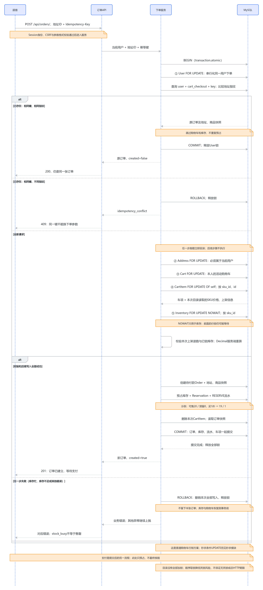

# MySQL与订单：从可靠交易到有证据的查询优化

2026-10-11。当前源码快照：`886600018badf0d157a6cd6d7164a308c4bd1c2b`。[项目总览](project-current-overview-study-guide.md) · [本轮文档与发布验证](../verification/mysql-interview-knowledge-base-publication.md)。

**这部分把两件事连起来：怎样在MySQL里保存一笔完整、可重放的交易，以及怎样让顾客合理地查看历史订单。事务、锁、幂等约束解决交易正确性；分页、关联查询和普通联合索引解决读取范围与成本，它们不能互相替代。**

它服务于你独立回答具体追问：订单为什么存快照？两个请求怎样避免重复下单？失败为什么不能只改回库存？每页20条为什么还要看SQL？联合索引实际改善了哪一步？最小充分证据已有：事务/幂等测试、真实隔离MySQL查询计划、正式迁移往返与页面分页检查。本轮只整理知识库，不追加数据库实验或迁移。

## 按五个问题理解MySQL在项目中的责任

| 问题页 | 读完能解释什么 |
|---|---|
| [下单为什么保存快照并使用事务？](mysql-interview/01-data-transaction.md) | 购买意图怎样成为历史交易；金额、地址、预占和流水为什么一起提交 |
| [幂等、行锁和数据库约束怎样配合？](mysql-interview/02-idempotency-locks.md) | 原意图重放、异参冲突、取锁顺序、唯一约束与单行规则各保护什么 |
| [分页为什么先过滤本人，再排序？](mysql-interview/03-pagination.md) | Session归属、20条封套、最新优先、同时间ID顺序、页码与并发变化边界 |
| [每页20单，数据库究竟做多少工作？](mysql-interview/04-query-cost.md) | COUNT、订单/地址JOIN、明细预加载；执行计划与物化/序列化/传输的区别 |
| [联合索引改善了什么，还剩哪些成本？](mysql-interview/05-composite-index.md) | 本人过滤与时间/ID排序怎样协作，5000→20是哪一步，深页与统计为何仍贵 |

每页以具体场景、完整流程、关键失败、理由与替代、核心代码、实际证据和“如果重新做”为主线。历史切片保留日期，不把一轮测试或AI解释当作已经独立掌握。

## 1. 为什么订单事实以MySQL为准

顾客浏览到鼠标129元、有货，在购物车放2件，又放一件59元的线材。这时购物车只是购买意图，没有库存预占，也没有固定成交金额。商品可能改价或被别人买走，浏览页、Redis副本或ES候选都不能替顾客保留交易条件。

下单时后端从Session确定顾客，检查地址归属，用本次读取的服务端SKU价格重新计算金额。假设仍为129元和59元，则总额317元；前端自报0.01元不能改变金额。Decimal（按十进制保存计算金额）与项目金额规则用于避免把二进制浮点近似直接作为成交金额。

成功后MySQL保存订单、商品明细、地址快照、每个SKU的预占和库存流水。地址属于当前资料，订单地址是购买当时的历史；SKU仍连接当前目录，订单明细中的名称、属性、单价则独立保存。这使改名、改价、编辑或删除原地址以后，顾客仍能看到原订单事实。UUID公开订单号降低猜号的便利，但读取权限仍必须按当前用户过滤。

支付确认、订单状态与库存效果也保存于MySQL；Mock网关成功响应或MQ收到消息本身不能等同于这些事实已经提交。Redis用于浏览副本及准入，ES用于文本候选，RabbitMQ用于已入箱支付事件的投递，这些责任均不取代交易数据库。[支付主线](payment-current-overview-study-guide.md) · [Redis主线](redis-current-overview-study-guide.md) · [搜索主线](search-current-overview-study-guide.md)

## 2. 普通下单怎样形成一笔不可半成功的交易

Transaction（事务，一组数据库操作整体提交或撤销）围住普通购物车建单。当前实际顺序是：

1. 锁本人User行，按“用户＋建单入口＋Key”查原订单，比较地址参数指纹。原意图直接返回原单；异地址复用Key返回409。
2. 新意图才继续锁本人地址、Cart、CartItem；CartItem按SKU/ID顺序，`of=("self",)`只锁车项，不因JOIN顺带锁共享SKU/Product/Category。
3. 按SKU顺序取得Inventory行锁，库存步骤用NOWAIT（遇到该锁已忙就立即报错）。User、地址或Cart锁仍可能等待；这不是全请求无等待。
4. 检查读取到的目录可售状态与锁住的库存，用服务端价格计算金额，创建Order、OrderItem和AddressSnapshot。
5. 库存从可售转为预留，写Reservation及RESERVE流水，删除本次CartItem，最后一起提交。任一步抛错，整个事务回滚。

<!-- DIAGRAM:order-sequence -->

[可编辑时序源](assets/mysql-interview-2026-10-11/order-sequence/diagram.mmd)。这是当前普通多SKU行锁流程；秒杀的单活动SKU条件UPDATE另见[秒杀主线](phase-6c5-flash-sale-inventory-failures-study-guide.md)，两种库存步骤不能混写。

以鼠标库存`available=20 / reserved=0`、购买2件为例，建单提交后是`18/2`，不等于售出2件。后来付款确认只核销原预占，使其变为`18/0`；未支付关闭释放则恢复`20/0`。支付、取消与过期是后续独立事务，不会让这个建单事务一直开着等待网关。[库存与交易生命周期](mvp-4-mock-payment-study-guide.md)

若鼠标预占已写，但线材后续流水失败，不能只“把鼠标库存加回去”然后继续保留半张订单。当前让异常退出整个数据库事务，订单、明细、地址、两份库存/预占/流水和购物车清理一起撤销。库存不足在当前实现的前置检查发现时，还没有写出新订单；真正验证后半段回滚，则需要故意在写入阶段制造失败，不能把两种测试混成同一过程。

重要限制也要保留：CartItem锁保护本人的购买项，目录联查只提供这次读取的报价/可售状态，**没有将全目录资料锁住直到提交**。快照表示实际采用并保存的那组值，不代表价格从加入购物车起冻结，也不宣称对所有并发变更有全局一致快照。

## 3. 幂等、行锁、约束不是同一件事

Idempotency（幂等，让同一购买意图重复请求不重复产生业务效果）解决“订单已创建但响应丢失”。客户端保持原Key与地址再次请求；后端先找到原单，所以即使购物车已清空，仍返回同一公开订单号，不再预占库存。

User行锁使同一顾客并发到达时串行检查；数据库唯一约束防止“用户＋建单入口＋Key”出现两张订单。这不意味着同一Key不能用于不同用户，也不意味着全站顾客都被一个全局锁串行化。代价是同一顾客的新订单也会在该用户行等待。

| 防线 | 主要责任 | 单独使用时的缺口 |
|---|---|---|
| 请求Key与参数指纹 | 判断原意图、重放或异参冲突 | 应用检查并发到达时仍可能竞争 |
| 关键行锁与事务 | 协调读取/修改顺序，保存完整业务效果 | `atomic`不会替你判断所有状态和业务规则 |
| 唯一与CHECK约束 | 拒绝重复身份和不合法单行数据 | 不会自动返回旧订单，不能独立核对跨表总额/完整生命周期 |
| 普通联合查询索引 | 支持本人过滤和排序 | 不是幂等唯一约束，不能阻止重复交易 |

金额公式、数量正数、库存非负是数据库能表达的部分规则；订单总额等于全部明细合计、预占与订单状态的对应关系，还需服务代码在同一事务中维护。即使库存每行都非负，也不能仅据此证明没有重复核销或错误释放。

按SKU取锁是降低不同请求交叉等待风险的选择，不是无死锁证明。NOWAIT繁忙和真实无货也必须分开：繁忙表示这次无法立即取得库存事实，无货是在取得保护后确认数量不足。

## 4. 顾客查看订单，需要归属、顺序和读取成本一起清楚

登录顾客请求`GET /api/orders/?page=2`。当前服务端先按Session对应的用户筛选，再按`-created_at, -id`排序，固定20条分页，返回`count/next/previous/results`及原明细和地址快照。

最新订单先显示，是订单历史的业务选择；ID在时间相同时确定顺序。原页面检查的45～26、25～6、5～1，是最新优先的模拟订单编号示例，不是所有业务列表都必须倒序。排序确定也不承诺跨请求冻结数据：期间新增或删除订单，下一页边界可能变化。

先截全站20条再过滤本人，会产生空页/短页、错误总数，甚至所有权风险。本人筛选必须进入查询，再统计和分页；`user_id`参数不能改变Session身份。详情也按本人查询，拿到他人UUID仍不能读取其订单。

当前非空页预加载地址和明细，在固定认证的APIClient验证中有三条订单数据SQL：统计总数、订单与地址JOIN、明细预加载。Prefetch（预加载，把这一页的关联明细集中取回）避免序列化每个订单时各查一次明细；它没有让COUNT或深页OFFSET消失，也不等于完整Session HTTP只有三条SQL。

20限制的是订单条数。每单可以有多个明细，完整JSON仍受明细、地址与字符串长度影响；当前没有任意规模订单响应字节数的硬上限。

## 5. 索引改变了哪一步，不能把数字说大

2026-10-09基线在可销毁MySQL里放入本人和他人各5,000单，每单两明细。旧全量、首页和第201页使用同一订单查询/序列化路径比较，记录SQL、实际计划、ORM物化、序列化和JSON渲染；“旧全量”是实验重建旧行为，当前API没有`all`参数。

分页已减少返回量，但原首页仍先读取本人5,000条订单候选、排序后取20。普通联合索引`(user, created_at, id)`与本人等值条件及两个倒序字段协作，反向扫描直接给首页20条，订单Sort消失。**5000→20只指这个订单索引步骤，不能说整个接口只访问20行。**

| 当前优化后的工作 | 仍然存在的成本 |
|---|---|
| 首页订单步骤输出20，地址查找20次 | COUNT仍读本人5000；明细40条及其自身排序仍存在 |
| 第201页返回20单 | OFFSET4000仍经过4020条订单/地址查找，再丢弃前4000位置 |
| 预加载集中读取关联数据 | 序列化和JSON仍要处理所有本页明细与字段 |

正式0005迁移只新增普通索引，原幂等唯一约束保留；隔离MySQL做过0004→0005→0004→0005往返并检查数据/响应。索引存在有环境区别：10/09正式化片没有迁移原开发库；10/11的9B新独立部署库已执行36项迁移，其中包含0005。本轮只核对这些记录，没有实时连接原开发库确认现在是否应用。

索引也有存储和写入维护成本；没有据此断言所有查询都更快。COUNT、深页与写入成本各有不同候选，不能用一个索引包办。详细计划和取舍见[查询成本](mysql-interview/04-query-cost.md)及[正式联合索引](mysql-interview/05-composite-index.md)。

## 6. 面试可引用的真实证据与时效

| 历史记录 | 已观察什么 | 不能扩大成什么 |
|---|---|---|
| [MVP-3，2026-09-18](../verification/mvp-3-order-inventory.md) | 隔离MySQL目标14 passed/9 subtests，全量94/27；金额、快照、失败、同Key并发与约束 | 当时未做支付/热点性能或浏览器E2E；后续已有支付不能冒充当轮验证 |
| [分页，2026-10-08](../verification/phase-3-order-list-pagination.md) | 真实MySQL目标28/171，回归63/8；页面模拟响应检查翻页/URL/重试 | 页面不是浏览器→真实HTTP→MySQL端到端；耗时不是接口性能 |
| [查询基线，2026-10-09](../verification/phase-3-order-query-baseline.md) | 合成10000单，实际COUNT/首页/深页计划与分阶段成本，临时候选对照 | 本地五轮中位数不含Session、HTTP、网络/浏览器，不能当生产p50 |
| [正式索引，2026-10-09](../verification/phase-3-order-list-index.md) | 正式迁移往返、字段与响应保留，首页/深页自动采用索引 | 计划单次观察不等于重复了五轮性能实验，不覆盖所有分布与写入压力 |
| [新部署库，2026-10-11](../verification/phase-9b-local-deployment-run.md) | 新库36迁移含0005、pending0 | 不代表原开发库也已迁移，或独立部署订单交易已经验收 |

这轮做的是静态源码、文档、图与飞书回读检查，不是重新运行上表实验。已有证据足够讲清机制与成本，先整理理解，不扩大负载或顺手改变事务策略。

## 7. 如果重新做，我会先改变什么

**我会保留模块化单体、MySQL交易事实、订单快照、事务和数据库最后防线。会更早画清写入不变量、锁顺序和完整读取路径，先测真实查询，再决定优化哪一步。**

如果购物车本身要成为不可变报价，需要新增报价版本/有效期与重放合同，不仅把更多当前目录行全锁住；这会带来失效、报价过期和用户提示成本。若同用户锁成为具体瓶颈，再比较以持久请求记录和唯一约束协调的方式，必须先明确并发冲突如何返回原结果，不能去掉锁后仅靠一次exists检查。

查询上会更早区分“返回少”“订单排序少做”“统计少做”“深页少跳过”。当前页码适合简单历史列表；如果真实需求常查很深的历史，再比较按时间/ID边界的游标及并发行为。游标通常改变跳页和总数体验，并没有自动形成全局快照。为性能删掉所有地址/明细也会改变当前业务合同，不能假装只是内部优化。

测试上会更早保护真实连接身份、隔离数据和清理范围，沿用[搜索隔离事故教训](../verification/phase-7b-test-isolation-incident.md)。下一步先用自己的话说明一笔建单、一次响应丢失和一次深翻页，不因知识库增加新候选就自动改业务、迁移数据库或追加实验。

## 历史切片入口

[建单与预占](mvp-3-order-inventory-study-guide.md) · [分页](phase-3-order-list-pagination-study-guide.md) · [真实查询基线](phase-3-order-query-baseline-study-guide.md) · [正式联合索引](phase-3-order-list-index-study-guide.md)。当前专题串起各片，原始日期、计划和边界继续保留。
