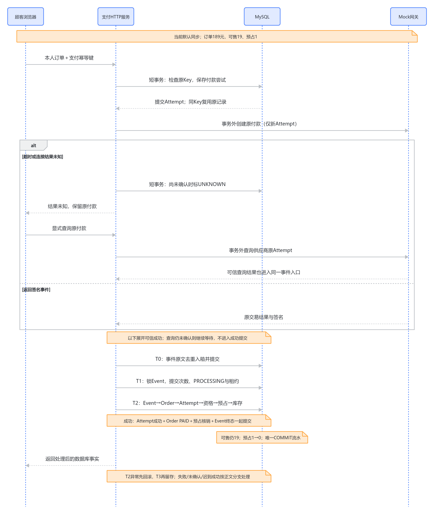
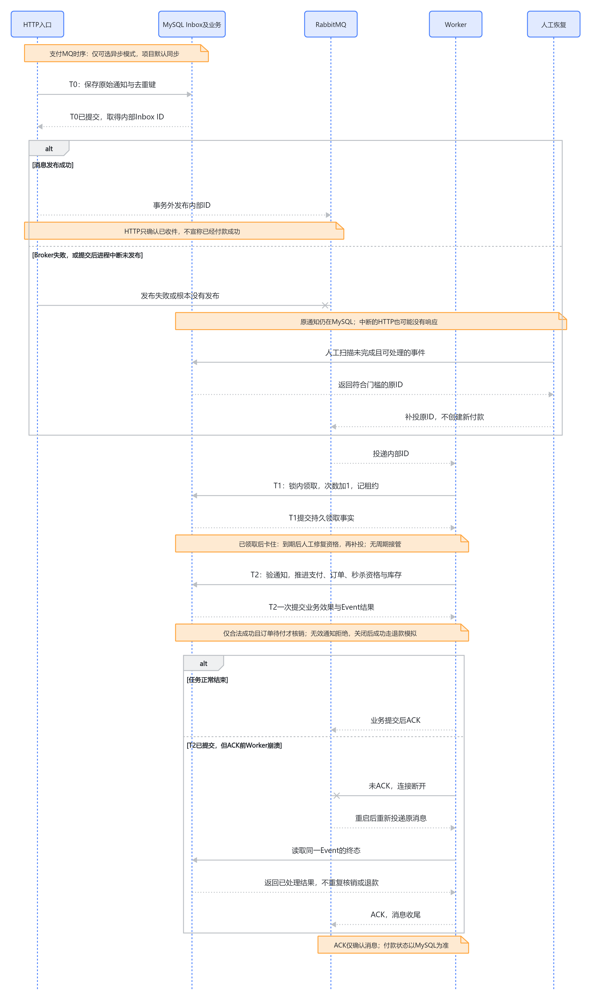
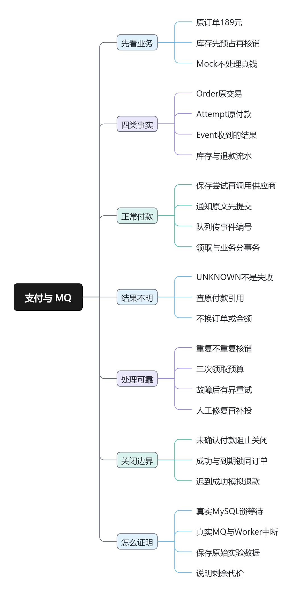

# 支付总览：怎样解释一笔189元订单的付款、幂等与故障恢复

2026-10-11，核对源码快照 `29b7944860080ccddedb2c0f0c060c0a27658376`，项目总纲 v1.16。[项目总览](project-current-overview-study-guide.md) · [本轮归档核对](../verification/payment-redis-interview-knowledge-base-restructure.md) · [飞书支付](https://ocnbkcx1ug58.feishu.cn/wiki/PCQ7wP9kMikz0eklmNYcH1J1nwh)。本页是支付面试阅读入口；历史切片保留原日期和实验环境，本次没有重跑支付或MQ实验。

## 面试时先讲清这一个问题

顾客买一只189.00元鼠标。下单已经把可售库存20、预占0变成19、1，但顾客是否真的付成功，不能由浏览器的一句“成功”、一次HTTP响应或一条MQ确认决定。通知可能重复、乱序；网关可能已处理但响应丢失；本地处理也可能在任意时刻中断。

这个模块的主线是：**先保存可恢复的交易事实，再验证供应商结果，通过同一套MySQL事务推进付款、订单和库存；遇到不确定结果先查清原付款，遇到处理故障则按资格有限恢复。** 项目使用不处理真钱的Mock Gateway（可控制结果的模拟支付供应商），没有第三方Sandbox、实际收款或实际退款。这是工程机制与隔离故障证据，不是生产支付规模经验。

在项目介绍中，可以围绕三句话展开：

1. **订单和一次付款分开。** 一次尝试明确失败不等于订单失败；UNKNOWN是“还不知道”，不能据此重新扣款。
2. **请求幂等、通知去重、业务幂等分开。** 它们分别解决重复点击、相同通知重复入箱、不同通知重复产生库存效果的问题。
3. **可靠留存和及时执行分开。** Inbox保存输入，MQ提供后台执行机会，MySQL事务决定业务结果，人工扫描覆盖漏投和未完成记录。

## 一笔付款完整地怎样运行

下单完成时，Order为PENDING_PAYMENT，库存19/1，Reservation为RESERVED；金额来自原订单快照，商品后来涨价也不改变这笔189元付款。普通订单或秒杀订单都沿用这条支付主线，秒杀额外维护购买资格。

**第一步，确认本人并创建原付款尝试。** 前端带订单UUID与支付Idempotency-Key（标识同一次请求的幂等键），Session确定当前顾客。短事务先锁User、查这个顾客已用过的Key：同Key同订单返回原Attempt，同Key换订单返回冲突。只有新Key才继续锁订单、检查待付状态及已有尝试。这个顺序很关键：第一次付款已经成功却丢失响应时，订单已PAID，原Key仍应返回原Attempt。先拒绝“订单不是待支付”就破坏了重放语义。

**第二步，提交Attempt，再调用供应商。** 等网络时不持订单/库存锁。供应商超时仅说明本地不知道结果；尚未确认的CREATED/PENDING变UNKNOWN，已经被并发通知确认的终态不会倒退。旧Key重放不会再次调用创建付款；显式查单询问原Attempt，普通GET只读本地。

**第三步，先保存供应商通知，再验证和应用。** T0（入箱事务）独立提交原始事件，按供应商与事件号去重；同号不同内容拒绝覆盖。无效签名改用内部摘要编号留审计，不能抢占后来合法通知的编号。处理时仍验签，核对供应商、订单、金额、币种与付款引用，签名正确也不代表业务内容正确。

**第四步，先持久领取，再原子提交业务。** T1只锁Event，保存处理次数、PROCESSING与默认60秒租约。T2再按Event→Order→Attempt→秒杀Purchase→Reservation→Inventory取得业务锁，在一个事务里提交Attempt成功、Order PAID、Reservation COMMITTED、预占1→0、唯一COMMIT流水与Event处理终态。可售仍19，因为下单时已经预占，付款再减可售会双扣。

**第五步，区分业务结果与处理故障。** 明确FAILED结束一次Attempt，不关闭Order；金额不匹配被REJECTED；MySQL暂态异常使T2整体回滚，再用T3单独记录失败类别和恢复资格。不能把“事件处理失败”改写成“顾客付款失败”。硬中断来不及运行T3，会留下持久PROCESSING，由租约修复处理。

<!-- BOARD:Cee6wMjj5hbDqRb2AHVc1uqunbh -->

图：默认同步付款的正常路径与网关超时。事务提交、外部等待和未知结果都有独立边界；当前代码细节以本文和下方问题页为准。

## 三类幂等怎样共同保护交易

| 重复发生在哪里 | 标识与保护 | 单独使用它还不够的原因 |
| --- | --- | --- |
| 顾客重复提交同一次付款 | `(user, idempotency_key)`唯一、请求指纹、先查旧Key | 换Key仍可能重复付款，因此还检查原订单已有未确认Attempt |
| 同一供应商通知重复到达 | `(provider, event_id)`唯一，保存原文 | 两个不同事件号仍可能描述同一笔付款成功 |
| 两个Worker处理同一交易 | Order/Attempt锁后重查状态、同一业务事务、流水与退款唯一约束 | 不能仅凭“Broker只送一次”或“我先查到待付”决定执行副作用 |

不同事件号的两名Worker会各锁自己的Event，但竞争同一Order。第一名提交成功后，第二名获得Order锁，重读Attempt SUCCEEDED，跳过库存核销并将自己的合法通知标为已处理。这是业务幂等，详见[重复、乱序与拒绝](payment-interview/04-idempotency.md)。

创建付款的显式锁顺序为User→Order→已有Attempts→秒杀Purchase；事件T1只锁Event；T2为Event→Order→Attempt→Purchase→Reservation（inventory_id/id）→Inventory（pk）；取消/到期从Order开始，不反向取得Event锁。排序降低互相等待的风险，但JOIN、索引、外键约束还可能引入物理锁，不能宣称完整InnoDB锁清单或所有死锁已消除。

## 为什么加入MQ，具体换来了什么

默认同步路径在T0保存原文后直接处理：部署简单、调用链短，但HTTP请求承担业务处理等待；进程中断或处理失败依赖原通知重投、查单或人工恢复。RabbitMQ（保存和投递消息的中间件）与Celery（后台运行任务的Worker框架）的可选路径，在T0提交后只发送Inbox内部整数ID，后台复用同一处理器，使收件和业务执行可以分别推进。

这解决的是**通知已经留存后，后台怎样执行和再次取得执行机会**。当前真实隔离证据验证了重复投递、有限重试、Broker停机补投、Worker硬中断恢复；没有测得生产吞吐、HTTP性能提升或自动恢复时限，不能直接说“用了MQ支付就快了”。MQ当前只允许本地开发/测试启用；新独立部署的PAYMENT_EVENTS_ASYNC显式关闭。

<!-- BOARD:VuDgwuZZNh0gYCb4vRCc5haDnph -->

图：可选MQ投递、Worker处理与人工补漏。Inbox提交到消息发布仍有窗口，Broker确认和Worker ACK都不能代替付款事实。

事件预算包含首次，最多3次，暂态失败后的等待门槛为5/10秒；无效通知、不变量破坏、耗尽预算必须停下。**这是同一Event的处理次数，不是同一订单新建Attempt的次数。** 后者由PAYMENT_MAX_ATTEMPTS控制，当前默认也为3，只有原尝试明确结束且订单仍可支付才允许新Key。重投事件不会重新发起付款。

现有`recover_payment_events`提供同步恢复、`--publish`人工补投、`--recover-stale`到期租约修复及dry-run/limit/event-id；先修复再处理或补投，不重置次数。当前保留人工兜底，没有周期扫描、心跳或无人值守接管保证。详见[MQ、有限重试与恢复](payment-interview/05-mq-recovery.md)。

## 失败路径最终影响什么

| 场景 | 189元订单及库存怎样变化 |
| --- | --- |
| 原Attempt明确FAILED | 订单仍待付，库存仍19/1；允许的新尝试从原订单189元快照创建 |
| CREATED/PENDING/UNKNOWN尚未确认 | 禁止新活跃尝试，也禁止取消/到期释放；预占可能超过15分钟 |
| 无未确认支付且关闭订单 | 预占释放一次，19/1→20/0，订单CANCELED或EXPIRED |
| 已关闭后可信成功迟到 | 原订单不复活，Attempt确认成功，模拟退款一次；保持20/0，不再核销 |
| 已支付未发货取消 | COMMITTED转RESTORED，可售19→20、预占仍0，模拟退款一次；秒杀已消费资格不释放 |
| 已发货 | 不走当前简单取消路径；本项目未实现复杂售后 |

HTTP202仅表示事件收件留存待处理/排查，Attempt的HTTP201仅表示创建成功；PROCESSED也可能对应供应商PENDING/FAILED。必须查看具体业务状态，不能把传输与处理状态当作支付成功。

## 带着具体问题进入七个子页

| 问题页 | 阅读后应能解释的设计 |
| --- | --- |
| [01 数据模型与两个状态机](payment-interview/01-models.md) | 为什么Order、Attempt、Event不能合成一个状态；哪些约束负责兜底 |
| [02 正常付款与事务提交](payment-interview/02-normal-payment.md) | 为什么先锁User、查旧Key，为什么外部调用必须在事务外，库存如何同事务核销 |
| [03 超时、UNKNOWN与原付款查单](payment-interview/03-unknown.md) | 超时为什么不能等同失败；查询原付款与再次付款的区别 |
| [04 重复、乱序与业务拒绝](payment-interview/04-idempotency.md) | 同事件与不同事件的重复分别如何处理；合法签名为什么仍会拒绝 |
| [05 MQ、有界重试与人工恢复](payment-interview/05-mq-recovery.md) | T0/T1/T2/T3、四类中断窗口、有限预算与恢复责任 |
| [06 支付与到期关闭、迟到模拟退款](payment-interview/06-expiration.md) | 为什么拿到锁不等于能关闭订单；释放、核销、恢复与模拟退款的差别 |
| [07 实验入口与面试证据](payment-interview/07-evidence.md) | 每项结论由什么真实实验支撑，以及哪些话证据还不支持 |

<!-- BOARD:EALVw0LZphx322b6q93ctTDxnne -->

原支付学习地图保留为定位辅助；当前状态和证据解释以七个问题页为准。当前能力来自持续演进的历史切片，文档更新不等于新实验或个人已经掌握。

## 如果重新做，优先改变什么

我会更早把“付款未知”“事件暂态处理失败”“提交后漏投”“领取后中断”写成四种不同故障，明确由查单、有限重试、人工补投、租约修复分别负责，并围绕它们设计状态和验证顺序。现有统一恢复命令已经实现，重做改变的是设计时机与职责表达，不应说成现在才发现需要恢复。

如果未来明确要求无人值守在固定时间内恢复，再评估受控周期扫描与告警，复用现有资格、预算及锁内复核。它增加调度故障、重复发布、饥饿和误报成本，不能自动把UNKNOWN判失败、重置EXHAUSTED或解封BLOCKED。当前学习范围没有这项SLA，因此不为文档重构自动增加调度平台或Outbox。

本专题停止于已有源码与历史证据足以解释上述机制。下一步是按正常付款和一个失败窗口独立讲述，再按实际代码变化维护相关页；不以多跑实验或增加支付功能代替理解。
