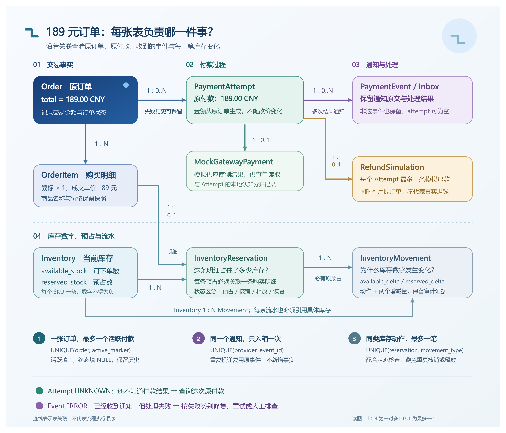

# 01 数据模型与两个状态机

2026-10-11，源码快照 `29b7944860080ccddedb2c0f0c060c0a27658376`。[支付总览](../payment-current-overview-study-guide.md) · [本轮核对记录](../../verification/payment-redis-interview-knowledge-base-restructure.md)。这页帮助解释“为什么支付不是在订单上加一个paid布尔值”；代码事实来自当前源码，实验结果使用历史记录，没有重跑。

## 一张订单为什么需要多个记录

顾客下了189.00元订单，第一次付款供应商明确拒绝，第二次付款成功。如果Order只有“待付/成功/失败”，第一次失败到底是订单失败，还是只结束这一次付款？当供应商通知再来一次，哪一条记录能说明它已经处理过？当网络超时，在哪里保存“供应商可能成功，但我暂时不知道”？

项目把三个问题拆开：Order保存购买交易，PaymentAttempt保存一次主动付款过程，PaymentEvent保存一次供应商通知及本地处理结果。拆分的收益是可以保留失败历史、查原付款、审计通知，并在重复和中断后准确定位原事实；代价是需要协调多个状态，查询与一致性规则比一个布尔值复杂。

| 记录 | 189元场景里回答什么 | 关键关系 |
| --- | --- | --- |
| Order | 买了什么、成交价多少、交易是否付款/发货/关闭 | 金额与商品/地址快照是原交易合同 |
| PaymentAttempt | 哪一次付款、供应商引用、结果是否确认 | 属于一个Order与顾客，金额/币种复制原订单 |
| PaymentEvent | 收到了什么原文、是否处理、还能否恢复 | 关联原Attempt；合法通知按provider/event_id唯一 |
| InventoryReservation | 这一件库存是否仍预占、已核销或已释放 | 属于原OrderItem，不因新Attempt重新预占 |
| RefundSimulation | 哪一次成功付款需要模拟退款 | 每Attempt最多一条，没有实际资金到账含义 |
| MockGatewayPayment | 模拟供应商实际保存了什么结果 | 每Attempt一条，查单读它而非浏览器提示 |

<!-- BOARD:FkR3wDLYqhbSxpb6T1Uc0RdxnDf -->



图：同一订单、多次付款尝试、事件和库存预占的关系。原图保留；下面解释当前状态与预算。

## “两个状态机”是两个业务对象，不包括全部处理状态

State Machine（状态机）就是“只允许按业务规则改变状态”的模型。两个主要业务状态机是Order和Attempt，Event另有本地处理状态；三者的成功不能混为一谈。

Order正常路径是PENDING_PAYMENT→PAID→SHIPPED→COMPLETED；待付订单在满足关闭资格时可以CANCELED/EXPIRED；已付款但未发货可以走简单取消与模拟退款。订单已关闭后可信付款成功迟到，不把订单复活，而是保留关闭状态、确认资金侧成功并记录模拟退款。

Attempt从CREATED开始，可信结果可以是PENDING、FAILED、SUCCEEDED；通信丢失可转UNKNOWN，可信查单或通知再确认结果。CREATED/PENDING/UNKNOWN都算未确认，会占用活跃位置。SUCCEEDED清空活跃标记且不能被后来的PENDING/FAILED倒退；FAILED清空活跃标记，满足规则时才可新建下一次Attempt。模型还定义EXPIRED/CANCELED，创建规则把它们视作可结束的历史状态；当前Mock通知只产生PENDING/FAILED/SUCCEEDED，不应把枚举存在说成每条迁移都已实现并验证。

Event的RECEIVED→PROCESSING→PROCESSED表示本地处理完成；PROCESSED也可能只是确认原Attempt PENDING或FAILED，绝不等于付成功。无效通知是REJECTED；处理异常是ERROR，再由failure_kind区分TRANSIENT（有限可重试）、BLOCKED（需要调查）、EXHAUSTED（次数耗尽）。UNKNOWN属于付款结果，ERROR属于通知处理，它们不是同一种失败。

## 两个默认“三次”限制分别保护什么

| 限制 | 单位 | 为什么设置 | 三次以后怎样 |
| --- | --- | --- | --- |
| PAYMENT_MAX_ATTEMPTS，默认3 | 同一Order创建过的不同Attempt | 约束主动付款尝试数量，保留历史；不是错误通知处理次数 | 不再为新Key创建Attempt；旧Key仍先返回原记录 |
| MAX_EVENT_PROCESSING_ATTEMPTS，固定3 | 同一Event进入处理的次数，包含首次 | 故障恢复不能无限占用资源；业务回滚不恢复预算 | 保留ERROR/EXHAUSTED，停止自动重试与普通恢复 |

例如Attempt A收到成功事件E，E处理库存时遇到1205，E可以从count1重试到count2。这仍是原A、原189元付款，不新增Attempt B，也不重新请求供应商扣款。只有A已被可信结果明确结束，订单仍待付、没有其他未确认尝试且未达到Attempt上限，顾客才可能用新Key创建B。

## 应用层检查与数据库约束各自负责什么

应用层先持User锁检查Key，再持Order锁检查活跃尝试，能解释冲突并返回稳定业务错误。数据库唯一约束是最后一道防线，防止其他写路径或并发遗漏制造重复记录。只写“先查是否存在”不够，两个事务可以同时查到不存在；只依赖唯一键又很难表达完整业务状态与友好错误。

核心定义来自[PaymentAttempt约束](../../../backend/apps/payments/models.py#L58)：

```python
models.UniqueConstraint(
    fields=("user", "idempotency_key"),
    name="payments_attempt_unique_user_key",
),
models.UniqueConstraint(
    fields=("order", "active_marker"),
    name="payments_attempt_one_active_per_order",
),
models.UniqueConstraint(
    fields=("order", "attempt_number"),
    name="payments_attempt_unique_order_number",
),
```

活跃Attempt的active_marker=1，终态为NULL。MySQL唯一键允许多条NULL，却不允许同一订单有两个`(order,1)`，因此可以保留多次失败历史，同时兜底“最多一个活跃尝试”。CheckConstraint还限制标记只能1/NULL；状态和标记的完整对应仍由业务服务维护，不应说数据库已经自动实现整个状态机。

付款幂等Key的范围是顾客，不是全站。两个不同顾客可以各用`pay-001`；同一个顾客用该Key支付另一张订单则请求指纹冲突。UUID是外部标识，不能代替归属校验；详情和查单仍限定当前user。

## 替代方案与重做选择

只有简单订单且没有支付失败历史，可以把付款标记放在Order上，开发成本低；一旦需要未知结果、第二次付款、重复通知及退款，单记录就很难回答“哪次请求发生了什么”。进一步拆成支付微服务可以独立部署，但会把本来同一MySQL事务的订单/库存变更拆成跨服务一致性问题。当前单商家学习项目选择模块化单体与多表事实，既能解释边界，又保留本地原子提交。

如果重新做，我会在建表前先用“第一次明确失败、第二次成功、第一条通知迟到”推演状态与标识，明确业务对象和消息处理对象的区别，再决定字段与约束。同时给未来枚举与当前实际可达状态写清说明，避免读者把EXPIRED/CANCELED误认为已跑通的Mock迁移。这改善设计表达与维护成本，不需要现在拆服务或补齐未要求的状态。

[历史MVP-4验证](../../verification/mvp-4-mock-payment.md)与[当前约束测试源码](../../../backend/apps/payments/tests/test_payment_models.py)支持数据合同和部分API行为；当前测试文件存在不等于本轮已运行。下一页沿[正常付款](02-normal-payment.md)解释这些记录如何按事务顺序创建。
