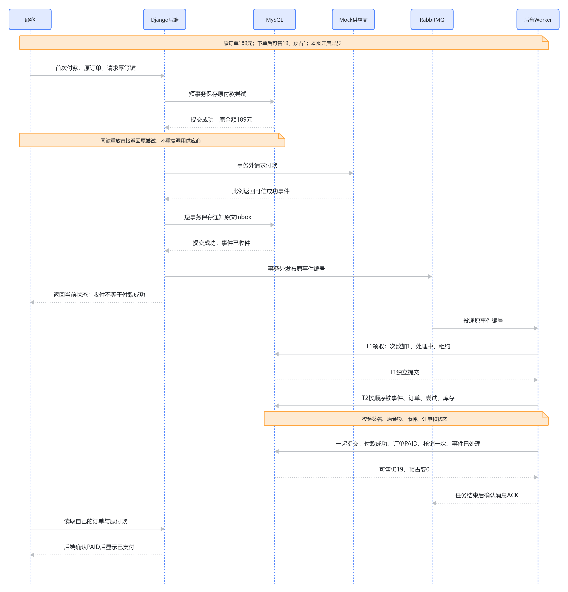

# 02 正常付款与事务提交

2026-10-11，源码快照 `29b7944860080ccddedb2c0f0c060c0a27658376`。[支付总览](../payment-current-overview-study-guide.md) · [本轮核对记录](../../verification/payment-redis-interview-knowledge-base-restructure.md)。本页重点是请求重放的检查顺序、网络与事务边界，以及付款/库存为什么一起提交；历史实验没有重跑。

## 从顾客请求到189元交易事实

前端对当前顾客的订单发起支付POST，附Idempotency-Key。Session识别本人，API验证请求形状，Service执行业务规则；金额与币种从数据库原Order读取，不接收前端报价。189元订单即使商品当前展示169元或199元，也只能按原189元付款。

此时订单待付，库存已经从20/0变19/1。付款处理不能重新创建订单或预占库存，它只创建付款尝试、询问供应商并确认原预占的归宿。API返回201说明新Attempt创建成功，200说明原Key重放；状态字段才能告诉顾客最终结果。异步启用时返回的Attempt可能仍未确认，不能只看到2xx就展示已付款。

## 为什么最先锁User，而不是直接锁Order

这个顾客的两个并发请求可能分别针对订单A、B，却误用了同一支付Key。只锁各自Order，两边不会互斥，可能同时查到Key不存在，最后靠唯一约束才撞车。锁User行让同一顾客的付款创建先后检查，跨订单也能统一判断旧Key语义，并给出明确冲突。代价是同一顾客同时支付不同订单也会串行，粒度比Order粗；本项目保持短事务，接受这个成本以获得清楚的错误语义。

检查顺序必须是**锁User→查原Key→新请求才锁Order并检查状态**。例如：

1. 顾客对A提交`pay-A`，Attempt #1付款成功，Order变PAID。
2. 成功响应在网络中丢失，顾客重发原请求。
3. 服务先查到`pay-A`属于A，返回原Attempt，既不新建也不再调用网关。
4. 如果反过来先检查A是否PENDING_PAYMENT，会因它已PAID而拒绝正常重放。

原Key配B则请求指纹不同，返回409；这是误用，不能把原A付款记录冒充B的结果。新Key配A也不等于允许重复付款：仍要检查A待付且没有CREATED/PENDING/UNKNOWN或已有成功Attempt，检查默认最多3次及秒杀HELD资格。

核心顺序来自[创建服务99行](../../../backend/apps/payments/services.py#L99)，外围函数有`@transaction.atomic`：

```python
user.__class__.objects.select_for_update().get(pk=user.pk)
existing = PaymentAttempt.objects.filter(
    user=user,
    idempotency_key=idempotency_key,
).first()
if existing is not None:
    if existing.request_fingerprint != fingerprint:
        raise PaymentRuleError(
            "idempotency_conflict",
            "这个 Idempotency-Key 已用于另一笔支付请求；请勿用同一个 Key 支付不同订单。",
            409,
        )
    return existing, False
```

这是特定事务上下文中的真实片段，不能移出事务后照抄锁调用。数据库唯一约束继续兜底，详见[数据模型](01-models.md)。

## 为什么Attempt先提交、供应商后调用

Transaction（事务）让一组数据库变化一起提交或回滚；行锁从事务取得后通常要等提交才释放。供应商网络可能慢、断线或响应丢失，如果在订单/库存锁内等待，会延长其他付款、取消、到期关闭的等待，而且数据库回滚也不能撤销供应商已经完成的付款。

所以`create_payment_attempt`先独立提交原Attempt，`start_payment`再在事务外调用Mock Gateway。已有原Key立即返回，不重新创建付款；尚未确认的超时标UNKNOWN。Attempt已经存在，即使在调用网关前中断，也能用原引用查单。在本项目Mock中查单允许补建同一Attempt的供应商记录；真实供应商需要按其幂等请求/查询协议实现，不能直接照搬模拟补建。

<!-- BOARD:WROkw8QXMhIRPrbm2sWcaPzBnOh -->



图：原Attempt提交、网络等待、Inbox收件与业务提交。原图保留；当前实现进一步将事件领取预算T1和业务T2分开，下方文字补充这一边界。

## 付款成功为什么必须同时核销库存

供应商签名结果先用T0提交原Event，再通过T1领取处理资格。T2执行时验证事件、取得Order和Attempt锁，检查金额币种与状态，再锁预占和库存。只有全部Reservation存在、为RESERVED且数量充足，才执行成功变化：

| 同一T2事务里的事实 | 成功后 |
| --- | --- |
| PaymentAttempt | SUCCEEDED，active_marker=NULL |
| Order | PAID |
| Reservation | COMMITTED |
| Inventory | 可售19不变，预占1→0 |
| InventoryMovement | 一条COMMIT，available_delta=0、reserved_delta=-1 |
| 秒杀Purchase（如有） | HELD→CONSUMED |
| Event | PROCESSED，并清失败/租约状态 |

可售库存已经在下单时减少，付款只是把“留给这张订单的一件”核销，不能再减一次可售。如果某件预占不对、写流水失败或秒杀资格不对，整个T2回滚，避免“付款已确认却只核销了一半”的本地矛盾。订单关闭后的迟到成功走模拟退款分支，不走这里。

关键成功分支来自[支付服务364行](../../../backend/apps/payments/services.py#L364)，位于T2业务事务中；后面Event终态也属于同一事务：

```python
elif outcome == "SUCCEEDED":
    purchase = lock_flash_sale_purchase(order, expected_status=FlashSalePurchase.Status.HELD)
    _commit_inventory(order)
    attempt.status = PaymentAttempt.Status.SUCCEEDED
    attempt.active_marker = None
    attempt.save(update_fields=("status", "active_marker", "updated_at"))
    order.status = Order.Status.PAID
    order.save(update_fields=("status", "updated_at"))
    transition_flash_sale_purchase(purchase, target_status=FlashSalePurchase.Status.CONSUMED)
```

## 锁顺序的作用及其限度

创建路径为User→Order→已有Attempts（attempt_number）→Purchase。事件T1只锁Event；T2为Event→Order→Attempt→Purchase→Reservation（inventory_id/id）→Inventory（pk）。取消/到期以Order开头，再依次锁Attempt、Purchase、Reservation、Inventory，不回头锁Event。每条路径在共同对象上保持一致方向，降低循环等待风险，多条库存再按固定顺序取得。

但这只是显式业务锁顺序。ORM的JOIN、索引扫描、唯一约束和外键检查可能增加物理锁，当前实验没有证明所有负载下无死锁；MySQL1205/1213仍可能发生，符合资格时按持久预算有限重试。

## 另一种做法与重做选择

可只依赖`(user,key)`唯一约束，用冲突后读取原记录代替User串行锁，可能减少同顾客跨订单互相等待；代价是必须仔细处理IntegrityError、事务回滚/重读及不同指纹冲突，不能把任意插入失败都当正常重放。当前实现优先清楚规则和短事务，没有证据说明User锁已成为瓶颈。

如果重新做，我会更早把“已成功但响应丢失”放入请求合同，固定先旧Key后状态的检查顺序；同时记录User锁粒度的成本。仅当同顾客并发支付确实出现等待证据，再比较更细粒度方案，不为了所谓高并发先加Redis分布式锁。数据库仍必须保留约束与业务状态检查。

[MVP-4记录](../../verification/mvp-4-mock-payment.md)包含正常支付与原Key重放，[5D记录](../../verification/phase-5d-payment-expiration-concurrency.md)观察同订单真实MySQL锁等待；它们不证明创建路径吞吐或所有锁竞争都已测过。异常处理与独立事务见[MQ与恢复](05-mq-recovery.md)，未知付款见[查原付款](03-unknown.md)。
