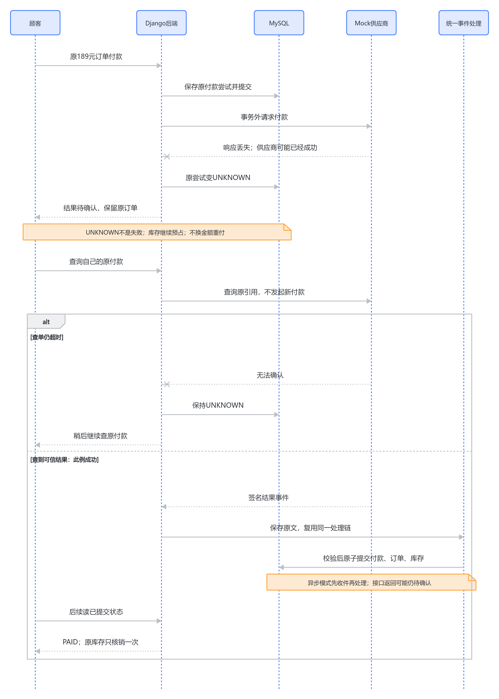

# 03 超时、UNKNOWN与原付款查单

2026-10-11，源码快照 `29b7944860080ccddedb2c0f0c060c0a27658376`。[支付总览](../payment-current-overview-study-guide.md) · [本轮核对记录](../../verification/payment-redis-interview-knowledge-base-restructure.md)。本页解释支付系统最重要的不确定性：客户端没收到结果，不代表供应商没有付款。这里的网关是Mock，无真实资金；本轮只核对源码和历史证据。

## 189元可能已经付了，为什么不能点“再试一次”

顾客提交Attempt A，供应商成功保存了付款，但返回189元成功结果时网络断了。我们的服务只看到TimeoutError：这既可能发生在供应商处理前，也可能发生在处理后，单凭异常无法判断。把A标FAILED并创建B，可能使顾客付两次；把A标SUCCEEDED，又可能给未付款的订单发货。

UNKNOWN（结果未知）表示本地暂时不能确认原付款，是知识状态，不是供应商明确拒绝。项目保留原A与原provider_reference，并让它继续占用活跃位置；顾客应该查询A。库存保持19/1，Order仍PENDING_PAYMENT，不创建第二次付款，也不强行释放预占。

CREATED和PENDING同样未确认：CREATED只说明原Attempt已保存，PENDING表示供应商仍在处理中。不能只保护UNKNOWN，否则刚提交或仍处理中的付款也可能被新Key绕开。这个保守策略牺牲部分库存周转，换取不重复付款、不把已付款顾客的货放给别人。

## 超时标记也必须防并发倒退

一种交错是供应商成功通知已被另一个请求处理，Attempt已经SUCCEEDED，而原创建请求刚刚超时。如果无条件写UNKNOWN，会把已确认成功倒退为不确定。项目用短事务锁原Attempt并检查当前状态：只有CREATED/PENDING才转UNKNOWN，终态原样返回。

真实核心片段来自[超时状态服务175行](../../../backend/apps/payments/services.py#L175)，外围函数有`@transaction.atomic`：

```python
attempt = PaymentAttempt.objects.select_for_update().get(pk=attempt_id)
if attempt.status in {
    PaymentAttempt.Status.CREATED,
    PaymentAttempt.Status.PENDING,
}:
    attempt.status = PaymentAttempt.Status.UNKNOWN
    attempt.save(update_fields=("status", "updated_at"))
return attempt
```

这项检查保护的是本地状态更新。外部调用仍在事务外，查询返回时也可能已有通知先确认；统一事件处理器再持锁判断是否可应用，不能相信发起查询时读到的旧状态。

<!-- BOARD:GqFMw6eOJhhPTNbOFa5cTvawnSd -->



图：网关超时后查询原付款，而不是创建新Attempt。若查单仍PENDING或再次超时，应停在未确认状态，不能继续进入成功核销。

## 普通刷新、原Key重放和显式查单是三种动作

| 顾客动作 | 会联系供应商吗 | 为什么 |
| --- | --- | --- |
| GET订单/Attempt、刷新页面 | 不会，只读取MySQL当前状态 | 查询接口保持读行为；刷新不隐式触发外部交易动作 |
| 原Key重发支付POST | 查到原记录后返回，不再次创建付款 | 恢复丢失响应；不能把重放变成第二次外部调用 |
| POST原Attempt的reconcile | 会询问原provider_reference | 主动查清原付款结果；返回可信事件也走同一验签/状态/库存入口 |
| 换Key支付同一未确认订单 | 拒绝新Attempt | 避免用新请求掩盖A的不确定结果 |

查询原付款的真实关键片段来自[查单服务629行](../../../backend/apps/payments/services.py#L629)：

```python
provider = gateway or MockGateway()
try:
    payload, signature = provider.query_payment(attempt)
except (TimeoutError, ConnectionError):
    return mark_attempt_unknown(attempt_id=attempt.pk)
receive_payment_event(payload=payload, signature=signature)
attempt.refresh_from_db()
return attempt
```

查单先按当前user筛选原Attempt；他人UUID返回不可见，UUID不是授权凭据。已确认终态直接返回；活跃状态才调用供应商。查单结果必须验签并匹配原189元订单，再通过原T0/T1/T2流程推进，而不是由接口直接把Order设PAID。这样查单、通知和MQ无需维护三套成功逻辑。

如果查到PENDING，A保持未确认；再次通信失败也继续未知；明确FAILED清空活跃位置但订单仍待付；明确SUCCEEDED按资格核销。MQ开关开启时，可信查单结果可能只完成入箱/发布，返回的本地Attempt暂时仍UNKNOWN，顾客还要读取之后的业务状态。

## Mock恢复与真实供应商边界

Attempt先提交，但进程可能在首次网关调用前中断，本地只剩CREATED且MockGatewayPayment还不存在。Mock的query会为同一Attempt补建一份供应商记录，使用同一引用生成事件；它没有创建第二个PaymentAttempt。这样可以演示“先保存原请求再恢复”的逻辑。

真实供应商是否允许查不存在订单、怎样幂等补发、付款与查询的超时语义，必须按它的协议设计。当前Mock没有外部网络或真实扣款，不能用它声称已经完成支付宝/微信支付集成，也不能把Mock的补建动作推广成“任何超时都重发扣款”。

另一种策略是等后台对账定期查询，让顾客只看状态，用户操作少但增加调度、速率限制、查询失败与恢复时限管理。当前选择顾客显式查单与人工兜底，依赖少且便于学习；没有周期对账或自动UNKNOWN恢复承诺。对高库存周转业务，这个等待成本必须单独评估。

## 如果重做，先明确等待与提示合同

我会更早写明UNKNOWN的页面提示、谁负责查单、多久后升级人工调查，以及库存能等待多久。当前保留15分钟后仍不强制释放是明确取舍，不应只告诉顾客“失败了请重付”。未来若有真正供应商与自动对账需求，再评估周期查单与告警，代价是外部调用限额、误报、长时间未确认和运维责任；不自动把超过某时长的UNKNOWN改FAILED。

[早期MVP-4记录](../../verification/mvp-4-mock-payment.md)保存了SQLite上的超时/查单烟测，不是MySQL锁或真实网关证据；[5D记录](../../verification/phase-5d-payment-expiration-concurrency.md)实际验证CREATED/PENDING/UNKNOWN阻止到期释放的六种MySQL交错。当前超时防倒退与查单细节是本次源码核对，不冒称本轮测试通过。继续看[支付与到期竞争](06-expiration.md)，理解这项保护如何影响库存。
