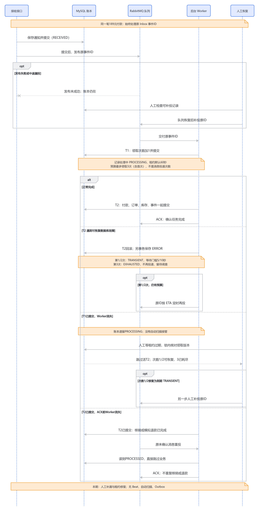

# 05 MQ、有界重试与人工恢复

2026-10-11，源码快照 `29b7944860080ccddedb2c0f0c060c0a27658376`。[支付总览](../payment-current-overview-study-guide.md) · [本轮核对记录](../../verification/payment-redis-interview-knowledge-base-restructure.md)。本页重点解释“通知存下来了，为什么还需要MQ、预算和恢复”；真实Broker/Worker实验引用历史记录，本轮不运行服务或恢复命令。

## 先讲业务场景，再讲中间件

189元付款的成功通知已经收到，但处理库存时MySQL暂时锁等待超时。如果只依赖当前HTTP请求，下次什么时候再处理？顾客不查单、供应商不重投，订单可能一直待付。MQ（消息队列，保存并投递待执行消息）提供后台执行机会，Celery Worker运行原处理器，使通知收件与业务执行分开推进。

本项目先实现同步处理+持久Inbox+人工扫描基线，再加入RabbitMQ/Celery。消息只传Inbox内部整数ID，原文、签名、尝试次数、付款事实保存在MySQL；Worker重新读取，不能相信消息自带的金额或状态。同步、MQ、人工恢复使用同一处理资格与业务规则，不另写一套后台支付状态机。

当前默认PAYMENT_EVENTS_ASYNC=false；MQ只允许development/test开启，新独立部署保持关闭。MQ实验确实使用了隔离RabbitMQ与Linux Worker，但这不表示部署里的MQ已启用，也没有真实第三方付款。后台化改善执行组织与故障恢复路径，没有当前HTTP延迟/QPS对照，不能编造性能提升。

## T0、T1、T2、T3为什么不能揉成一个事务

| 事务 | 独立保存什么 | 为什么必须这样分 |
| --- | --- | --- |
| T0收件 | 原Event原文及签名 | 后续业务失败也保留输入；提交后才能发布ID |
| T1领取 | count加1、PROCESSING、started/lease | 处理失败仍消耗预算；不能与业务一起回滚 |
| T2业务 | Attempt/Order/库存/流水/资格/退款及Event终态 | 本地业务效果必须全部提交或全部回滚 |
| T3错误留存 | 稳定错误、failure_kind、next_retry_at | T2已经回滚后仍能保存失败原因；不能在坏事务中继续写 |

如果count也在T2里，故障导致事务回滚，count会退回旧值，永久失败可以无限“第一次重试”。如果T0也与T2同事务，处理失败连收件也丢失，就没有可恢复原文。如果持数据库锁发布消息，Broker断线会拖长交易锁等待，但仍没有MySQL与Broker的共同原子提交。

入口拒绝已经处于外层atomic的调用，保证T1/T3真正独立提交。核心协调代码来自[服务531行](../../../backend/apps/payments/services.py#L531)：

```python
if connection.in_atomic_block:
    raise ValueError("事件处理入口必须在外层事务之外运行。")
event, processing_attempt = _claim_event_processing(
    event_id=event_id, as_of=as_of if as_of is not None else timezone.now()
)
if processing_attempt is None:
    return event
try:
    return _process_claimed_payment_event(
        event_id=event_id, processing_attempt=processing_attempt
    )
except Exception as error:
    _record_event_processing_failure(
        event_id=event_id,
        processing_attempt=processing_attempt,
        error=error,
        as_of=as_of if as_of is not None else timezone.now(),
    )
    raise
```

T1锁Event复查资格，只允许首次RECEIVED或已到期TRANSIENT ERROR且未耗尽者领取；T2重新锁Event并核对PROCESSING/count版本。T3也核对同一版本，防止旧处理者写错误覆盖新处理者或已提交终态。`processing_attempt`是领取时的持久版本，不是Celery task ID。

## 什么时候能重试，什么时候必须停

重试条件由MySQL保存，不由“抛了异常就重来”决定。当前只把MySQL OperationalError的1205/1213分类为TRANSIENT；库存/秒杀资格不变量、其他数据库异常、未知程序异常进入BLOCKED。无效签名、金额、币种或状态冲突是REJECTED，不是需要重试的ERROR。

同一Event最多处理3次，包含首次。暂态失败count1后至少等待5秒，count2后至少等待10秒；count3失败为EXHAUSTED且无next。失败时的业务变化回滚，但T1保存的次数仍在。正常成功只消耗这次次数；终态重复任务不再加次数。

核心退避来自[T3失败记录477行](../../../backend/apps/payments/services.py#L477)：

```python
if kind == PaymentEvent.FailureKind.TRANSIENT:
    if event.processing_attempt_count >= MAX_EVENT_PROCESSING_ATTEMPTS:
        event.failure_kind = PaymentEvent.FailureKind.EXHAUSTED
        event.next_retry_at = None
    else:
        event.next_retry_at = as_of + timedelta(
            seconds=EVENT_RETRY_BASE_SECONDS * 2 ** (event.processing_attempt_count - 1)
        )
else:
    event.next_retry_at = None
```

付款Attempt默认最多3次是另一条规则：限制同Order新创建付款尝试数量。E处理失败重试仍是原A的通知，不重新调用供应商付款，也不创建B，详见[两个预算](01-models.md)。

## Celery为什么不用另一套retry次数

Celery任务设置`max_retries=0`，不让框架为同一逻辑单独计算业务预算。任务处理后重读数据库，只有ERROR/TRANSIENT、count1或2且有next时，才发布原ID的后续消息；ETA为数据库到期与“当前+1秒”的较晚者，避免定时器提前几毫秒唤醒后立即循环。

早到或重复消息可能没有取得T1资格，也可能再安排一条后续消息。因此**消息条数、ACK条数可以大于3，但实际领取处理总次数最多3**。仅看Rabbit队列空、ACK增加或Task日志成功，不能说明189元订单已经PAID；业务终值仍看MySQL。

`acks_late=True`在任务处理后确认，`reject_on_worker_lost=True`为Worker丢失保留重投机会。Publisher Confirm（Broker接受发布的确认）降低已知发布失败的不确定性，但不确认数据库付款；Worker提交后ACK前中断仍可能重投，要靠[业务幂等](04-idempotency.md)。

<!-- BOARD:XyAXwlGotha4ilbXPsqcurCKnue -->



图：消息处理与人工补漏。当前恢复进一步包含租约修复；原图与下面四类故障文字共同阅读，不能把一次发布成功看作恢复完成。

## 四个窗口分别由谁负责

| 中断/依赖故障窗口 | MySQL留下什么 | 继续路径 |
| --- | --- | --- |
| T0提交后，首次或重试消息发布失败 | RECEIVED/count0，或到期ERROR/TRANSIENT；原文不丢 | 恢复Broker后人工`--publish`原ID；默认同步也可人工处理 |
| T1提交后、T2前Worker中断 | PROCESSING/count1，业务未变 | 租约到期后人工`--recover-stale`，再处理/补投；不退回count0 |
| T2已写但未提交时Worker中断 | 独立连接看不到业务变化；原T1持久存在 | 断连接后T2回滚；租约修复后以剩余预算继续 |
| T2提交后、ACK前Worker中断 | PROCESSED与PAID/库存或退款已提交 | 原消息重投遇终态，跳过；不修复为ERROR、不再次核销/退款 |

T0前根本没有成功留存的输入，需要调用方重发，不能靠扫描不存在记录解决。Attempt提交后网关调用前/结果丢失，是付款查单问题，详见[UNKNOWN](03-unknown.md)，不要把它当Inbox租约问题。T3自身失败或硬中断来不及进入except，同样可能留下PROCESSING；程序日志不能替代持久状态。

## 租约到期为什么还不能直接接管

Lease（租约）给一次领取设置截止时刻，默认60秒，便于识别可能中断的PROCESSING。但活Worker可能只是慢：T2还持有Event锁，此时扫描用`select_for_update(skip_locked=True)`跳过，不能仅因时间到就并行接手付款。

扫描先固定候选，逐条短事务复查状态、原count、原lease及时间。修复时count小于3转ERROR/TRANSIENT且立即有资格，count3转EXHAUSTED；不执行支付、不发布、不重置预算。旧T2/T3后来回来，因状态或版本不匹配不能污染新处理者。没有租约证据的历史PROCESSING不能从received_at猜测接管。

当前没有心跳续租或周期自动扫描。人工修复只是第一步，之后还需要同步处理或`--publish`；`--recover-stale`和`--publish`互斥，所以先修复、再补投。命令还提供dry-run、limit、内部event-id。指定ID不会绕过BLOCKED/EXHAUSTED，`DJANGO_ENV=test`也不会把单独管理命令自动切到pytest临时测试库，实际操作必须先确认目标。

## 替代选择与如果重做

同步处理+Inbox扫描依赖最少，也是默认基线，但请求承担等待、恢复依赖人工。只做周期扫描可省Broker，不过执行延迟受扫描间隔、候选排序影响。MQ给及时后台执行，仍需扫描补漏，同时新增Broker/Worker、发布与ACK窗口。事务Outbox（先在数据库保存待发送意图，再由发布者发送）是更系统的可靠发布方案，但还要管理发布者、重复、积压与清理；当前支付已有入箱可恢复事实，不能因为术语更高级就把Outbox列为已采用或必须扩展。

如果重新做，我会更早将“可靠留存、允许重试、及时执行、崩溃恢复”分别设计，再接MQ；当前演进先5A扫描、再5B资格、再5C投递，保留了观察基线限制的收益。未来若业务要求无人值守恢复时限，优先在已有资格与租约上评估受控调度、候选公平性与告警；代价是调度故障、重复发布、饥饿和误报，不能自动重置耗尽记录或忽略BLOCKED。

[5B规则记录](../../verification/phase-5b-payment-event-retry.md)证明持久预算与分类的隔离MySQL行为；[5C2](../../verification/phase-5c2-payment-mq-retry.md)真实制造1205验证等待/耗尽；[5C3](../../verification/phase-5c3-payment-publication-recovery.md)真实停Broker验证两种漏投；[5C4](../../verification/phase-5c4-payment-worker-recovery.md)实际SIGKILL验证领取后、业务提交前、支付提交后ACK前、模拟退款提交后ACK前四个场景。证据没有自动恢复SLA、Broker重启后的全部持久化场景或多Worker生产负载结论。现有证据足够解释机制，本次不新增故障矩阵。
