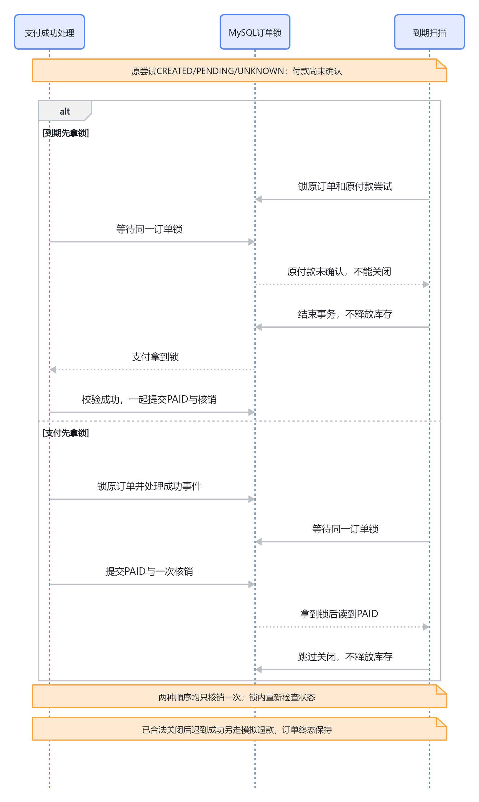

# 06 支付与到期关闭、迟到模拟退款

2026-10-11，源码快照 `29b7944860080ccddedb2c0f0c060c0a27658376`。[支付总览](../payment-current-overview-study-guide.md) · [本轮核对记录](../../verification/payment-redis-interview-knowledge-base-restructure.md)。这页解释资金结果、订单关闭和库存周转之间的取舍，特别是“先拿到锁的人为什么不一定能关闭”；历史MySQL实验未重跑。

## 15分钟到了，为什么库存仍可能19/1

189元订单下单时预占一件，库存20/0→19/1，Reservation记录15分钟expires_at。到期时间表示订单可以进入关闭资格检查，不承诺时钟一到自动恢复库存，更不代表供应商付款失败。

假设付款A还CREATED/PENDING/UNKNOWN：供应商可能正在处理或已经成功但我们没收到。此时强行释放库存，另一位顾客可以买走这件，而原顾客稍后付成功，系统就必须处理退款/缺货。项目选择保守策略：先查清原A，不关闭、不释放。因此15分钟后的库存保留是业务取舍，不是“到期扫描坏了”。代价是未确认付款可能占库存更久，当前没有自动对账或释放时限。

关闭流程先锁Order，再锁已有Attempt并重查未确认状态。核心检查来自[订单生命周期40行](../../../backend/apps/ordering/lifecycle_services.py#L40)：

```python
attempts = list(
    PaymentAttempt.objects.select_for_update()
    .filter(order=order)
    .order_by("id")
)
if any(attempt.status in UNRESOLVED_PAYMENT_STATUSES for attempt in attempts):
    raise OrderLifecycleError(
        "payment_unresolved",
        "支付结果尚未确认，请先查询原支付结果，再关闭订单。",
        409,
    )
```

调用者持Order锁且处在atomic事务中，未确认集合为CREATED/PENDING/UNKNOWN。不能只检查订单待付或最早读到的Attempt状态；也不能在事务外先查好，拿锁后直接相信旧结果。

## 到期与付款两个执行者先后怎样决定结果

<!-- BOARD:LxS7wKkWJhP8hwbr5SocRy0FnFc -->



图：支付与到期竞争同一Order锁。先取得锁只能先检查资格，不会绕过未确认付款保护。

**付款先取得Order锁：** 到期线程等待。付款在同一T2提交PAID/SUCCEEDED、库存19/0、COMMIT一条，释放锁。到期拿锁重新发现订单已不是PENDING_PAYMENT，返回changed=False，不释放库存。

**到期先取得Order锁：** 订单虽已到期，仍有未确认A，所以它返回payment_unresolved并退出事务，不修改Order或库存。付款随后取得锁，验证并提交相同成功结果。两个顺序都保持货留给可信付款者，不取决于哪段代码先开始。

[5D真实实验](../../verification/phase-5d-payment-expiration-concurrency.md)将这两个顺序分别与CREATED/PENDING/UNKNOWN组合，实际六场景都最终PAID/SUCCEEDED、库存19/0、COMMIT1。实验观察了MySQL实际锁等待，不是只在程序里sleep。它验证同订单服务层交错，不是HTTP/MQ负载或所有InnoDB死锁场景。

## 没有未确认付款时，怎样释放与避免重复

若根本没创建Attempt，或原尝试被可信结果明确结束且没有其他未确认付款，待付订单可取消/到期关闭。关闭服务锁秒杀HELD资格、Reservation及Inventory，核对全部预占仍RESERVED且数量足够，再整体提交：可售19→20、预占1→0、Reservation RELEASED、唯一RELEASE流水、Order CANCELED/EXPIRED；秒杀HELD资格变RELEASED，可按活动规则再次购买。

原Attempt FAILED只结束付款，不直接释放库存，因此“付款失败”和“关闭订单”是两个动作。重复取消已CANCELED返回未变化；重复到期发现不是待付也退出。流水唯一约束再兜底，任何事实不一致均回滚并调查，不能悄悄把库存加一。

## 已关闭后189元成功迟到，为什么不重新扣库存

例如A已明确FAILED，订单正常关闭并释放20/0，但后来收到A的可信成功。资金侧事实不能装作没收到，原订单又不该被复活去抢现在可能已卖给别人的库存。项目选择保留关闭订单、确认Attempt成功、记录一次RefundSimulation（退款模拟记录）。

这个分支在一般Attempt终态冲突检查之前。真实代码来自[支付服务327行](../../../backend/apps/payments/services.py#L327)：

```python
if order.status in {Order.Status.CANCELED, Order.Status.EXPIRED} and outcome == "SUCCEEDED":
    # 可信的迟到成功代表资金侧已成功；订单已关闭，库存不可再次核销或释放。
    # RefundSimulation 与 Attempt/Event 一同提交，重放由 Attempt 唯一关系兜底。
    attempt.status = PaymentAttempt.Status.SUCCEEDED
    attempt.active_marker = None
    attempt.save(update_fields=("status", "active_marker", "updated_at"))
    simulate_refund(
        order=order, attempt=attempt, reason=RefundSimulation.Reason.LATE_SUCCESS
    )
    event.processing_status = PaymentEvent.ProcessingStatus.PROCESSED
    event.error_code = "late_success_refund_simulated"
    event.processed_at = timezone.now()
    event.save(
        update_fields=("attempt", "processing_status", "error_code", "processed_at")
    )
    return event
```

前面已经验签并核对原订单、189元和币种；不是任何“成功”字符串都能触发退款。RefundSimulation按Attempt一对一并匹配原金额，重复事件和不同号重复成功复用原记录。这个分支不调用核销/释放，库存仍20/0，COMMIT0、已有RELEASE1。它与Attempt/Event一起提交；故障回滚后按原事件资格恢复，提交后ACK前重投不再次退款。

## 已支付未发货取消，为什么是RESTORE

正常付款成功后库存19/0，Reservation已COMMITTED。此时取消不能再次执行RELEASE，因为已经没有那一件预占。它应让可售19→20，预占仍0，Reservation RESTORED、流水RESTORE一条，并对原成功Attempt模拟退款、Order CANCELED，一起提交。已发货则拒绝当前简单取消；本项目没有复杂售后。

秒杀资格已从HELD变CONSUMED，付后取消仍保留CONSUMED，避免“买到后退款就重新获得活动资格”反复占用优惠。待付取消释放HELD是未完成购买，付后取消不释放CONSUMED是已经消费资格，两者有不同业务语义。

| 动作 | 起点 | 结束库存 | 订单/资格 |
| --- | --- | --- | --- |
| 付款COMMIT | 19/1，RESERVED | 19/0 | PAID；HELD→CONSUMED |
| 待付关闭RELEASE | 19/1，RESERVED | 20/0 | CANCELED/EXPIRED；HELD→RELEASED |
| 付后取消RESTORE | 19/0，COMMITTED | 20/0 | CANCELED；CONSUMED保留 |
| 关闭后迟到成功 | 已20/0、已RELEASED或RESTORED | 不再变化 | 原关闭状态保留，模拟退款最多一条 |

## 另一种取舍与如果重做

可在15分钟后无条件关单，再用迟到退款补偿，库存周转更快，却增加已付款顾客被退款、缺货和资金对账成本；一旦真实供应商支持可靠关单/撤销，也可以先确认支付侧关闭，再释放。当前Mock没有跨系统原子关单协议，因此选择未确认付款保留库存。

如果重新做，我会更早把“15分钟是资格门槛，不是必定释放”写入业务合同，并将保守等待与到期后退款两种策略的用户体验、库存占用、供应商能力列明。未来真正有高库存周转需求，再以可接受等待和支付侧关单能力决定调整；不能仅加一个定时任务就声称解决资金与库存一致性。

[5C4真实SIGKILL记录](../../verification/phase-5c4-payment-worker-recovery.md)包含迟到退款提交后ACK前中断，终值保持退款1、RELEASE1、COMMIT0；[6B资格生命周期](../../verification/phase-6b-flash-sale-lifecycle.md)提供秒杀资格相关隔离MySQL证据。模拟退款是后端留存记录，没有实际资金退回。新独立部署只验证基础运行与Session/CSRF，尚未验收这条部署环境交易闭环。
