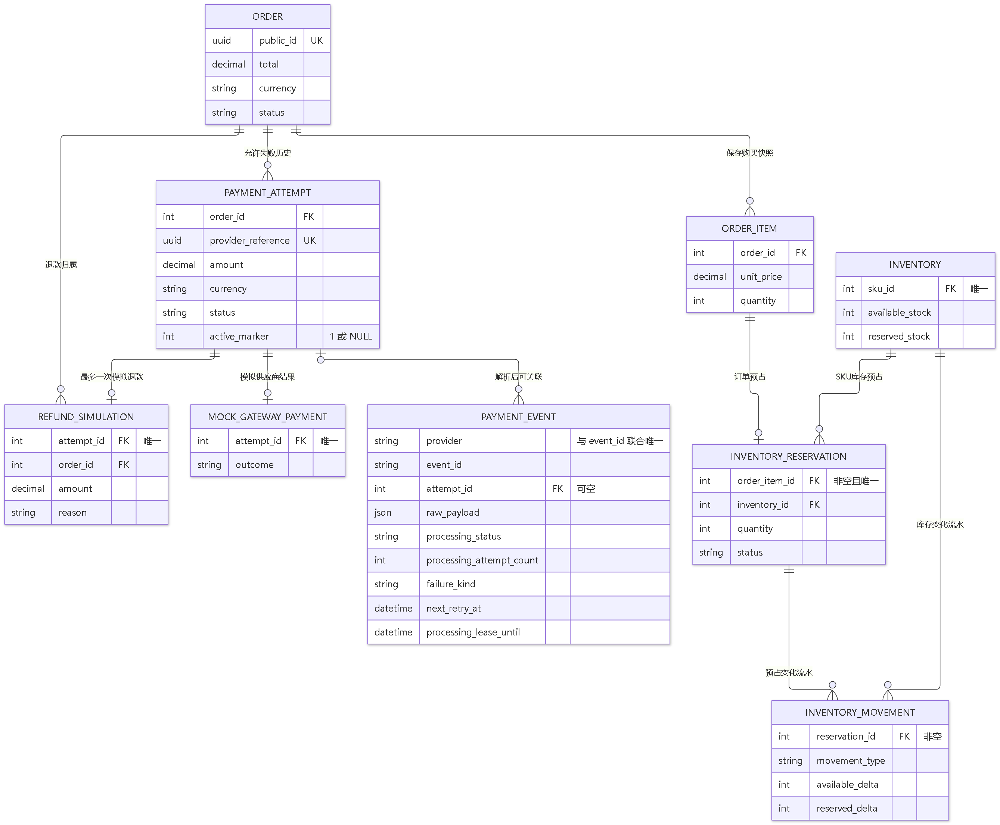
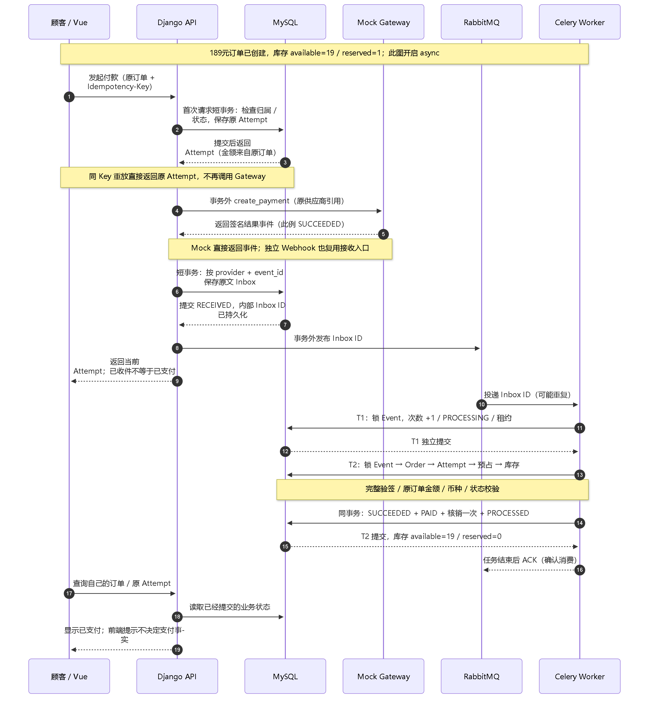
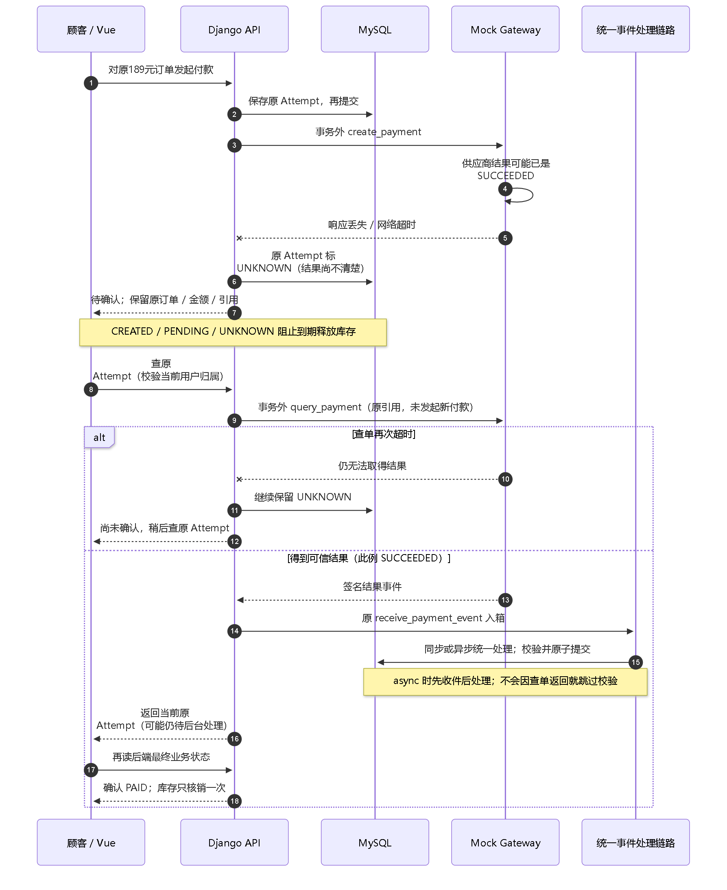
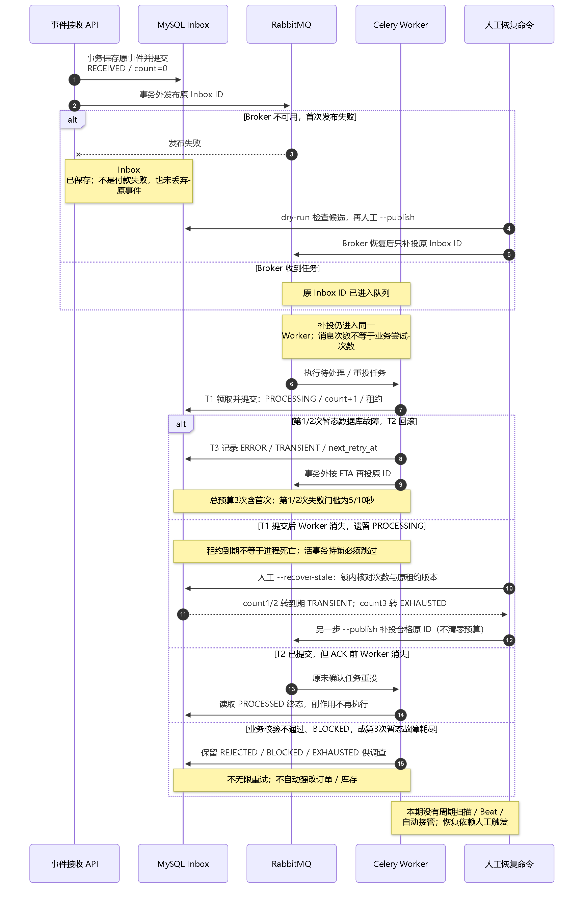
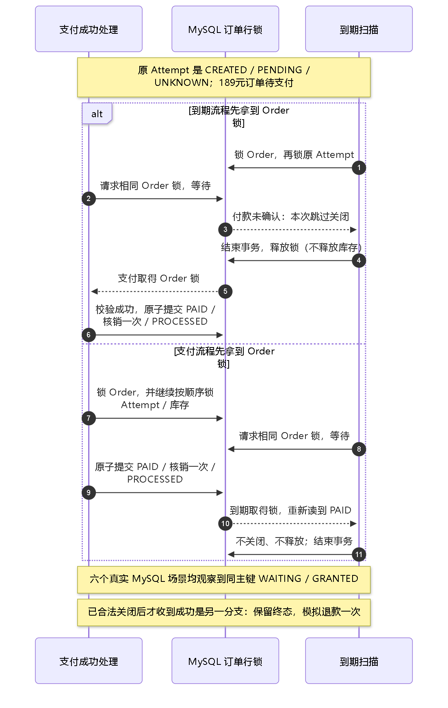

# 支付与 MQ：从189元订单理解数据、事务和故障恢复

核对日期：2026-10-06。对象：Project One 当前工作区源码及已经保存的实验记录。
这是支付资料的统一阅读入口，属于支付 Depth 主线的学习整理；不改变业务设计。
当前 main 基点为 `2dacc9a`，C4/5D 实现与证据仍含未提交增量，仅检出该提交不足以复现全文。
本次读取并参考[已有 Redis 文档](https://ocnbkcx1ug58.feishu.cn/docx/KKBXdHFQqoZRCNxJv1YcFb29nkf)
的业务边界、流程、方案对照与证据卡结构；没有重新运行应用测试，也没有操作业务数据库。
图示依据实际源码绘制，图片成功渲染不等于重新验证业务。资料尚未发布到飞书 Wiki。

## 先记住支付究竟负责什么

支付模块负责回答三个问题：原付款有没有成功；可信结果怎样改变订单和库存；
重复消息、超时或后台进程故障之后怎样继续处理而不重复产生副作用。
本项目使用 Mock Gateway（可控制结果的模拟支付供应商），没有真实资金或第三方 Sandbox。

业务闭环：浏览 → 登录 → 购物车 → 地址 → 下单并预占库存 → 付款并核销库存 → 模拟发货 → 收货。
Redis 保护浏览读取；支付确认原交易；秒杀保护集中抢购与限购。三者是同一业务闭环中的不同模块。
秒杀产生的订单继续复用本支付流程，不需要再造一套秒杀支付。

建议先顺着189元订单读本页四张时序图，再按问题进入既有阶段指南；不用按阶段编号逐篇从头背诵。
Sequence Diagram（时序图）从上往下显示“谁先调用谁、哪里提交、谁在等待”。
ER Diagram（实体关系图）说明表之间的归属和数量关系，不表示执行顺序。

## MySQL怎样规划：一套交易事实，按职责分表

保持一个 MySQL 数据库、现有 Django 模块化单体。现在不需要按支付拆库、分库分表或增加财务总账。
Database Constraint（数据库约束）是数据库拒绝重复或非法记录的最后一道检查；
Service（业务服务）在事务里检查跨表规则并推进状态。两者共同保护交易。

| 对象 | 它记录的事实 | 为什么单独保存 |
| --- | --- | --- |
| Order / OrderItem | 买了什么、购买时价格数量、原交易金额、订单状态 | 商品后来调价，不改变已经创建的189元订单 |
| PaymentAttempt | 顾客针对原订单的一次付款尝试、供应商引用、金额和付款状态 | 付款尝试失败不等于订单失败；同订单允许失败历史，但最多一个活跃尝试 |
| PaymentEvent / Inbox | 收到了什么通知、签名与原文、处理状态、次数、错误和租约 | 知道付款结果与成功处理该结果，是两件不同的事 |
| InventoryReservation | 哪个订单明细占用了多少库存、是否核销或释放 | 同一个库存预占不能既核销又重复释放 |
| InventoryMovement | RESERVE / COMMIT / RELEASE / RESTORE 流水 | 解释库存前后值，检查重复副作用 |
| RefundSimulation | 原成功付款的一次模拟退款事实 | 已关闭订单迟到成功等分支需要幂等记录；不代表真实钱已退回 |
| MockGatewayPayment | 测试替身自己的付款结果 | 本地 UNKNOWN 时查它；它不是第二次顾客付款 |

图仅列理解支付所需的字段，完整用户、SKU、地址快照等关系见源码。
InventoryReservation 的 order_item 非空且唯一；每条预占必须关联一条订单明细。
InventoryMovement 的 reservation 也非空，记录 available_delta / reserved_delta 增减量。
Event 尚未解析或无效时 attempt 可空。

必须认识的约束和规则：

- `(user, idempotency_key)` 避免同一用户重复创建付款尝试；重放还要核对请求内容。
- `(order, active_marker)` 唯一：活跃尝试填1，终态填NULL，利用 MySQL 允许多个NULL的唯一键语义。
  状态与标记一致性、成功后禁止新付款仍由业务服务维护，不是数据库自动推导。
- `(provider, event_id)` 唯一防重复收件。相同编号不同原文会被拒绝；无效签名使用内部摘要编号，
  避免伪造事件抢占后续合法编号。入箱后仍完整验证签名、金额、币种、订单和状态。
- `(reservation, movement_type)` 唯一防同类库存流水重复；RefundSimulation.attempt 一对一防重复模拟退款。
- 金额使用 Decimal 与两位小数，付款金额来自原订单快照；不能拿当前商品价格、Redis浏览价或前端金额付款。
- Order / Attempt / Event 金额相等等跨表规则在业务事务内检查；不能说所有不变量都是 SQL Check 约束。

索引从实际查询和实验出发：原 Attempt 定位、事件唯一键、到期恢复候选等。
当前没有证据要求重建表或批量加索引；以后数据量导致扫描变慢时，再按查询计划比较方案。
这是“保留简单单库”与“拆库或先加大量索引”的取舍：前者事务清楚、学习成本小；
后者增加一致性或写入成本，需要真实负载理由。

## 两个状态不要混成一个

| 状态属于谁 | 例子 | 应该做什么 |
| --- | --- | --- |
| PaymentAttempt.UNKNOWN | 供应商可能已扣款，但付款请求的响应丢了 | 查原付款引用，不新建订单或换金额重付 |
| PaymentEvent.ERROR | 已经保存结果事件，处理时数据库事务出错 | 按原事件的失败分类、预算和到期门槛重试或调查 |
| PaymentEvent.RECEIVED | 原文已经保存，还未处理 | 异步消息可待投递；收件不等于付款成功 |
| PaymentEvent.PROCESSED | 这个事件的处理已提交 | 可能是处理中或失败结果；还要看 Attempt / Order，不能一律解释为付款成功 |
| PaymentEvent.REJECTED | 签名、金额或状态等业务校验不合格 | 保存拒绝原因；不无限重试 |

订单主链是 PENDING_PAYMENT → PAID → SHIPPED → COMPLETED，取消/到期为终态。
付款主链可以是 CREATED → PENDING/UNKNOWN → SUCCEEDED 或 FAILED；具体转换由现有服务决定。
Event 的处理状态表示后台进度，不代替订单状态。

## 图一：正常付款从前端到库存核销

本图显式使用 `PAYMENT_EVENTS_ASYNC=true`。默认配置仍为同步：入箱提交后直接执行同一处理服务，
不经过 RabbitMQ/Worker；异步目前限 development/test，不能写成已经上线的生产链路。
Mock create_payment 当前直接返回签名结果，独立 Webhook 使用相同接收入口。
图示一种可能交错，Worker也可能先于HTTP响应完成。相同Key重放直接返回原Attempt，不再调用Gateway。

189元鼠标初始可售20。下单已经将库存变为可售19、预占1；付款成功将预占1核销为0，
可售仍19，不能付款时再扣一遍可售库存。

三个关键提交边界：

1. Attempt 先提交，Gateway 调用在事务之外。网络等待期间不占订单或库存锁。
2. Inbox 原文单独提交，再发布内部 ID。当前源码是显式 atomic 退出后直接发布，
   没有 on_commit 回调，也没有 Outbox；提交到发布之间仍可能中断，需要人工补投。
3. Worker 的 T1 独立提交领取次数、PROCESSING与租约；T2共同提交付款、订单、库存效果与事件处理状态。
   T2回滚不清零T1预算。成功提交后任务结束，再由 Celery ACK（告诉队列本次消息已消费）。

Webhook 异步202表示原文已保存，即使 Broker 发布失败仍可能202；MQ ACK也不等于业务上的付款成功。
顾客应读取后端已经提交的 Order/Attempt 状态。

核心代码入口：[付款服务](../../backend/apps/payments/services.py)、
[发布器](../../backend/apps/payments/dispatch.py)、[后台任务](../../backend/apps/payments/tasks.py)。
详细操作和对照：[Mock基线](mvp-4-mock-payment-study-guide.md)、[MQ基础链路](phase-5c1-payment-mq-study-guide.md)。

## 图二：付款请求超时，怎样查询原付款

UNKNOWN只是“不知道”，不能解释为失败、退款或回滚已经发生。
用户换一个 Idempotency-Key 也不能绕过活跃 Attempt 再付。
`reconcile_payment_attempt` 校验归属，查询原供应商引用；再次超时继续UNKNOWN，
收到结果也要入箱并经过相同校验。异步时本次查询返回仍可能待处理，后续再读状态。

原金额始终189.00；商品现在涨价为209.00不改变这笔交易。没有新订单，没有第二次支付请求。
本地 Mock 可以为缺失的原付款记录补建测试替身；不要推广为真实供应商都能安全再次扣款。

查单入口 `reconcile_payment_attempt` 与 Inbox 恢复入口不同：前者询问供应商，后者处理已经保存的原文。
完整代码见[付款服务](../../backend/apps/payments/services.py)和[Mock Gateway](../../backend/apps/payments/gateway.py)。

## 图三：消息漏投、重试与Worker中断

Retry Budget（重试预算）是最多允许领取多少次事件处理资格。本项目总共3次含首次；
可恢复故障后的下一次资格门槛为5秒、10秒。重复消息不自动占用新次数，Celery消息数量不等于数据库预算。
T1领取后即使尚未进入T2便中断，也已经消耗一次；T2回滚或领取后中断不会退回次数。

Lease（处理租约）是本次领取在数据库记录的截止时间，默认60秒；C4测试使用8秒。
它不是订单15分钟库存截止，也不是自动计时器或“到点证明进程已死”。
人工修复时仍在T2持锁的事件被跳过，锁内还要核对原次数及租约版本，不能覆盖后来领取。

| 故障事实 | 处理原则 | 代价 |
| --- | --- | --- |
| Inbox已保存但发布失败，或提交后到发布前崩溃 | Broker恢复后人工补投原Inbox ID | MQ自己不知道数据库里的漏投；没有自动恢复时限 |
| T2数据库暂态故障回滚 | T1次数保留，记录TRANSIENT，合格Worker发布ETA重试 | 到期资格不保证准时执行；发布也可能失败 |
| Worker消失留下PROCESSING | 人工dry-run → 到期租约修复 → 再执行恢复/补投 | 持锁、空租约和耗尽事件仍需调查 |
| T2提交后ACK前中断 | 原消息重投，PROCESSED短路，不重复核销或退款 | 是幂等副作用，不是消息恰好投递一次 |
| REJECTED / BLOCKED / EXHAUSTED | 保留原事件与错误供调查 | 不自动强改状态，不无界重试 |

本期选择显式人工恢复，尚未引入Beat、周期扫描、心跳或Transactional Outbox。
替代方案是自动扫描/Outbox，但会增加调度、发布记录和运维边界；以后有真实需求和证据再决定。
现有确认过的人工兜底不能被文档写成无人值守自动接管。

读法：先[人工Inbox恢复](phase-5a-payment-inbox-recovery-study-guide.md)，
再[持久预算](phase-5b-payment-event-retry-study-guide.md)，
然后[后台重试](phase-5c2-payment-mq-retry-study-guide.md)、
[发布补漏](phase-5c3-payment-publication-recovery-study-guide.md)、
[Worker中断恢复](phase-5c4-payment-worker-recovery-study-guide.md)。

## 图四：付款成功与订单到期同时发生

Row Lock（行锁）让两个流程按顺序修改同一订单；拿锁后还要检查状态，才能决定有没有资格操作。
CREATED/PENDING/UNKNOWN 三种原Attempt均阻止关闭。因此到期先拿锁也不意味着它能关单：
它只能报告payment_unresolved并保留库存。支付先拿锁则完成PAID，到期随后读到PAID，不再操作。

代价：未确认付款可能让库存超过15分钟继续预占，需要查清原付款，不能为了及时释放而猜付款失败。
六场景真实MySQL观察在[5D指南](phase-5d-payment-expiration-concurrency-study-guide.md)。

另一分支必须单独理解：订单已经合法CANCELED/EXPIRED，后来收到可信SUCCEEDED，
保持订单终态、确认原付款并最多创建一次LATE_SUCCESS模拟退款，不再核销或释放库存。
已支付未发货取消则恢复原核销库存并模拟退款；已发货/完成拒绝简单取消。
原Attempt FAILED但订单尚未关闭收到矛盾成功，现有实现拒绝terminal_attempt_conflict，
不要讲成“任何成功通知都能重新打开订单”。见[取消与退款证据](../verification/phase-2b-refund-simulation.md)。

## 核心代码应该怎样读

按调用链找入口，不先通读几百行：

| 需要理解的问题 | 函数或文件 |
| --- | --- |
| 发起付款如何防重复 | services.py：create_payment_attempt → start_payment |
| UNKNOWN如何保留原付款 | services.py：mark_attempt_unknown → reconcile_payment_attempt |
| 原文怎样先独立提交 | services.py：receive_payment_event |
| T1预算与T2业务怎样分开 | services.py：_claim_event_processing → _process_claimed_payment_event → process_payment_event |
| Broker发布和ETA | dispatch.py：publish_payment_event；tasks.py：process_payment_event_task |
| 人工恢复怎样挑选合格事件 | recovery.py；management/commands/recover_payment_events.py |
| 订单到期为什么不能盲目释放 | ordering/lifecycle_services.py：expire_pending_order → _close_pending_order_locked |
| 哪些唯一关系兜底 | payments/models.py；inventory/models.py |

每次只选一个函数：用“整体作用 → 执行流程 → 关键代码 → 189元前后值 → 完整链路位置 → 常见错误”学习。
少量关键摘录已在阶段指南中，不重复复制整个模块，避免后续源码变化后多份代码互相矛盾。

## 历史证据卡：这次只核对，没有重跑

| 证据入口 | 历史真实结果 | 可以支持的主张 |
| --- | --- | --- |
| [5A](../verification/phase-5a-payment-inbox-recovery.md) | 目标12 passed、5 subtests，10.75s | 保存原Inbox，人工恢复；两个真实MySQL并发扫描 |
| [5B](../verification/phase-5b-payment-event-retry.md) | 目标26 passed、12 subtests，18.08s | 预算持久、到期门槛及受控死锁次数保留 |
| [5C1](../verification/phase-5c1-payment-mq.md) | 原始记录3 passed，44.27s | 独立Worker、真实RabbitMQ、重复与伪造通知 |
| [5C2](../verification/phase-5c2-payment-mq-retry.md) | 原始记录3 passed，70.58s | 真实1205故障后的后台重试、BLOCKED与耗尽 |
| [5C3](../verification/phase-5c3-payment-publication-recovery.md) | 最终原始记录2 passed，71.69s | Broker故障后的首次/重试漏投人工补发 |
| [5C4](../verification/phase-5c4-payment-worker-recovery.md) | 4 passed，81.71s | T1后、T2未提交、支付/退款提交后ACK前的真实中断 |
| [5D](../verification/phase-5d-payment-expiration-concurrency.md) | 六例6 passed，11.47s | 两种锁顺序×三个未确认状态，真实记录锁等待，核销一次 |

5D阶段支付/订单回归：157 passed、12 skipped、83 subtests，100.14s。
12项是当轮未配置的MQ组，不能当作该轮MQ通过；C4阶段独立重跑C1/C2/C3分别3/3/2通过，
加C4四项真实MQ共12项通过。不同日期/命令的结果不能拼成一次执行。
这些秒数是测试总耗时，不是请求延迟、吞吐、恢复SLA或生产性能。

原始JSON与源码指纹在对应verification文件旁，5A/5B并非每条断言都有独立JSON。
本次静态整理不增加商业支付、真钱退款、多机容灾、线上流量或全部死锁排列的证据。
实际图片渲染和文档链接检查与历史业务测试是两类验证。

## 面试怎样讲，怎样判断自己是否理解

两分钟介绍参考：我的电商项目以MySQL保存交易事实，189元订单下单时先预占库存。
支付保存原Attempt再调用Mock，网络超时保留UNKNOWN并查询原引用。可信结果先持久入Inbox，
异步Worker在独立事务保存领取次数，再原子提交付款、订单、库存和事件处理结果。
唯一键、状态检查与行锁保证重复消息不产生第二次副作用；MQ不承诺消息只出现一次。
本地真实RabbitMQ/Worker实验验证了重复、锁超时、Broker漏投和进程中断；MySQL六种锁竞争验证到期不会误释放。
本期选择人工修复和补投，没有周期自动恢复、真实支付供应商或生产性能证据。

| 追问 | 需要能自己解释的答案 |
| --- | --- |
| 为什么Order、Attempt、Event分开？ | 交易本身、一次付款、收到结果后的处理进度是不同事实 |
| UNKNOWN与ERROR区别？ | UNKNOWN要查原付款；ERROR处理已有原文，两者恢复入口不同 |
| 有MQ为何仍需Inbox？ | 数据库先提交到发布前可崩溃；Broker也可能不可达 |
| 为何预算先提交？ | 业务事务回滚不能把已经消耗的尝试次数清零 |
| 60秒到了就抢占？ | 不是死亡证明；先跳过持锁事务，核对领取版本再修复 |
| 收到202或ACK能显示已支付？ | 不可以，读取后端已经提交的付款和订单状态 |
| 到期先拿锁为什么没有关单？ | 原付款尚未确认，不具备关闭资格，锁不代替业务判断 |
| 现在最大的代价？ | 人工恢复没有自动时限，UNKNOWN占库存，单体/本地实验证据有限 |

这只是学习与口述参考，不表示项目作者已经独立掌握。先能用189元例子解释四张图，再读核心源码。

## 飞书知识库怎样放，与秒杀怎样衔接

未来共享一个 Project One Wiki，在其下分别组织项目总览、订单/库存、Redis、支付/MQ、秒杀/并发。
Redis已有材料复用。支付本页对应00总览，后续按
[文档规范与SOP](payment-documentation-sop.md)拆为问题节点；本地指南和实验原始证据继续保留在Git。
Wiki中“学习概念/操作步骤/真实证据”通过链接关联，不把所有阶段日志堆进一篇正文。

秒杀属于库存并发主线：顾客集中抢同一活动SKU时，要防超卖、重复成功订单并说明失败补偿。
新聊天第一步只读已有库存基线并明确活动范围、限购规则和测试Oracle，不直接引入Lua或改支付。
先复用现有Phase3失败及方案对照，再选择下一片核心逻辑；不要重复已经完成的超卖实验。
