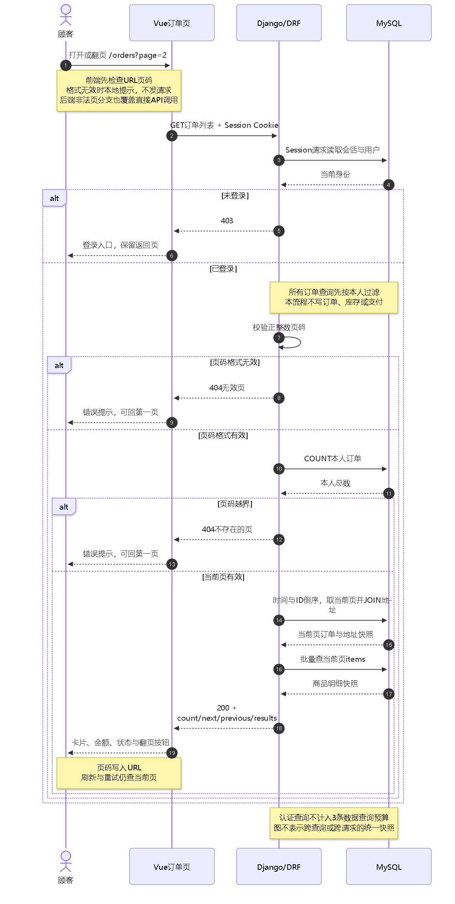

# 订单列表分页学习指南：从“查看全部订单”到“按页查看本人订单”

日期：2026-10-08。适用实现：[bbc20ca](https://github.com/jasper507/E-commerce/commit/bbc20ca0c865d030e62448de9f851dd29ec4d908)。

配套材料：[验证记录](../verification/phase-3-order-list-pagination.md)、[目标测试原始输出](../verification/phase-3-order-list-pagination-target-output.txt)、[相关回归原始输出](../verification/phase-3-order-list-pagination-regression-output.txt)。

**这一片的结论：订单列表每次最多返回20笔本人订单，顾客能够翻页、刷新恢复当前页、失败重试，并进入原有订单详情流程。** 它尚未证明SQL变快，也没有解决深页查询和跨请求数据变化的全部问题。

本指南补写时核对了当前源码、框架实现和前片原始输出，只进行文档检查与流程图渲染；没有重新运行应用、数据库或浏览器测试。下文测试结果来自上述已执行记录，不是本次补文的新实测。

这片支撑的能力是：把一个页面需求落实为有权限边界、有确定排序、有异常恢复的前后端接口；能回答“分页解决了什么、为什么用了索引还可能慢、怎样证明没有N+1查询、为什么不直接用游标分页”。源码用于核对机制，最终要能不看代码讲清楚因果关系。

## 1. 这个part形成了什么业务闭环

项目已有主流程是：浏览商品 → 登录 → 购物车与地址 → 下单及库存预占 → Mock支付与库存核销 → 模拟发货 → 确认收货。本片补的是顾客再次进入系统时，如何找到和继续处理自己的历史订单。

```text
已登录顾客打开“我的订单”
→ 后端识别当前身份，只查询本人订单
→ 返回当前页的订单、地址和商品快照
→ 页面展示订单状态、金额与详情入口
→ 顾客翻页查找更旧的订单，或刷新当前页查看最新状态
→ 点击某笔订单进入原有详情页
→ 在详情页按后端业务规则付款或确认收货
```

这个闭环的关键是“查得到、查对人、能继续操作、失败能恢复”。列表只是读取和展示订单，不创建订单，不预占库存，也不会把订单改成已支付。付款与收货仍由已有接口和业务服务处理。

工程实现闭环已形成；本片浏览器验证使用模拟响应，真实浏览器→HTTP→MySQL端到端验收仍有缺口。用户独立讲述也需要另行检查，收到指南不等于已经掌握。

## 2. 原来有什么问题，这次具体改变了什么

原来的GET /api/orders/把当前用户的全部订单交给OrderSerializer，再整体返回。一个用户只有几笔订单时，问题不明显；历史订单变多后，每次打开页面都需要读取、组织和传输更多订单。

假设某用户有45笔订单，这是教学场景，也是前片浏览器模拟数据的数量：

| 页面动作 | 原实现 | 当前实现 |
|---|---|---|
| 首次进入 | 返回全部45笔 | 返回最新20笔 |
| 查看更旧订单 | 已经全量加载 | 请求第二页20笔、第三页5笔 |
| 刷新第三页 | 原列表没有页码 | URL保留page=3，再请求第三页 |
| 请求失败 | 显示失败状态 | 显示失败，可重试当前页 |

**减少的是一次返回和处理的订单数量，不是已经测出的毫秒数。** 每笔订单仍包含完整商品明细和地址：20笔大订单可能比20笔小订单的响应大。因此，页长限制不是响应字节上限，也不是数据库扫描行数上限。

本片保留订单详情结构和交易逻辑，便于把“分页的影响”和后续“索引的影响”分开判断。

## 3. 必须守住的业务规则与接口契约

| 规则 | 当前行为 | 原因 |
|---|---|---|
| 只能读本人订单 | 用request.user过滤；客户端user_id无效 | 登录身份必须由服务器确认 |
| 总数也属于本人 | count统计过滤后的订单 | 他人订单不能混入总数或页数 |
| 一页最多20笔 | 后端固定page_size=20 | 客户端不能用page_size=1000恢复全量读取 |
| 新订单排在前面 | -created_at，再-id | 同一时间也有确定的排列顺序 |
| 无订单不算错误 | 第一页200，results为空 | 这是正常业务状态 |
| 不存在的页不冒充空订单 | 非法或越界页码404 | “没有订单”和“页码错误”不同 |
| 单条订单结构不变 | 仍返回状态、金额、地址、items等 | 已有详情、付款入口继续复用 |

正常入口为GET /api/orders/，省略page等同第一页；第二页为GET /api/orders/?page=2。本片不接受last页码别名。0、负数、非数字、带小数和越界页码等已覆盖案例返回404。

分页响应的外层从数组变为对象：

| 字段 | 含义 | 45笔订单第二页的值 |
|---|---|---|
| count | 当前用户的订单总数 | 45，不是20 |
| next | 下一页链接，没有则null | 指向第三页 |
| previous | 上一页链接，没有则null | 指向第一页 |
| results | 当前页的订单数组 | 20笔 |

真实后端通过DRF构造分页链接，可能是包含协议和主机的完整URL。当前前端只用next/previous是否为null判断按钮边界，再自行改变page参数，不直接请求返回的链接。

无订单时的完整外层响应是：

```json
{"count": 0, "next": null, "previous": null, "results": []}
```

只有GET集合响应变了。POST /api/orders/下单仍返回一笔订单；GET /api/orders/<public_id>/详情也仍返回一笔订单。public_id是对外使用的UUID，排序用的内部id不是这个UUID。

## 4. 完整请求流程：谁在什么时候做什么



[可编辑Mermaid源文件](assets/phase-3-order-list-pagination-flow.mmd)。图展示当前读取流程，不表示新增了交易事务或数据库快照。图里的alt表示条件分支，一次请求只走符合条件的路径，不会把所有分支都执行一遍。

用“用户已登录，打开第二页”把图读成一次完整运行：

1. Vue Router恢复URL中的page=2，页面计算currentPage=2。
2. loadOrders调用fetchOrders(2, signal)，浏览器发送GET请求，并按同源规则携带Session Cookie。
3. Django/DRF按Session识别当前用户；IsAuthenticated拒绝未登录请求。本项目当前配置下未登录返回403。
4. OrderCollectionView.get调用orders_for(request.user)，产生只包含本人订单的QuerySet。
5. 分页器验证页码，并在需要判断页数时统计本人订单总数。
6. 对有效第二页，计算从第21笔开始取最多20笔；由ORM把切片转为数据库查询范围。
7. 查询当前页订单时关联加载地址；随后批量加载这些订单的商品明细。
8. OrderSerializer把当前页的数据组织为API字段，分页器加上count、next、previous。
9. 前端将响应保存到orderPage，模板读取results展示订单卡片和翻页按钮。
10. 点击下一页改变URL，watch触发新请求；刷新则重新从URL恢复页码。

这里的QuerySet是“用Python对象描述一组数据库查询”的工具，ORM是“把这些对象操作转成SQL”的桥梁。构造查询不等于马上把全部数据取回来：真正取数据发生在统计、求值和序列化所需对象加载时。[Django查询执行说明](https://docs.djangoproject.com/en/5.2/topics/db/queries/#querysets-are-lazy)

这是GET读请求，当前fetchOrders没有发送X-CSRFToken；同项目的下单等写请求仍需要Session/CSRF保护。不要把这片的读请求重试规则直接搬到购买请求上，购买重试还必须遵循原Idempotency-Key规则。

## 5. 读代码前，先认清每个文件的职责

以下链接固定到实现提交bbc20ca，避免main以后变化使本指南摘录失真。

| 文件与核心位置 | 负责什么 |
|---|---|
| [order_urls.py](https://github.com/jasper507/E-commerce/blob/bbc20ca0c865d030e62448de9f851dd29ec4d908/backend/apps/ordering/order_urls.py) | 把订单集合与详情URL映射到View |
| [views.py：orders_for、OrderPagination、get](https://github.com/jasper507/E-commerce/blob/bbc20ca0c865d030e62448de9f851dd29ec4d908/backend/apps/ordering/views.py#L144) | 本人查询、排序、关联加载、分页与响应 |
| [serializers.py：OrderSerializer](https://github.com/jasper507/E-commerce/blob/bbc20ca0c865d030e62448de9f851dd29ec4d908/backend/apps/ordering/serializers.py#L134) | 把订单和历史快照组织为API字段 |
| [orders.ts：fetchOrders](https://github.com/jasper507/E-commerce/blob/bbc20ca0c865d030e62448de9f851dd29ec4d908/frontend/src/api/orders.ts#L65) | 发请求、传页码、携带会话与取消信号、处理HTTP失败 |
| [OrdersView.vue](https://github.com/jasper507/E-commerce/blob/bbc20ca0c865d030e62448de9f851dd29ec4d908/frontend/src/views/OrdersView.vue) | 从URL取页码、加载、展示和异常恢复 |
| [catalog.ts：PaginatedResponse](https://github.com/jasper507/E-commerce/blob/bbc20ca0c865d030e62448de9f851dd29ec4d908/frontend/src/types/catalog.ts#L32) | 描述分页封套；订单复用已有泛型类型 |
| [test_order_list_pagination.py](https://github.com/jasper507/E-commerce/blob/bbc20ca0c865d030e62448de9f851dd29ec4d908/backend/apps/ordering/tests/test_order_list_pagination.py) | 验证分页规则、快照、归属、错误页和数据查询预算 |

HTML/CSS无需逐行背诵。重点是能指出身份来自哪里，哪一步限制订单数量，哪个条件触发请求，哪一步把数据库对象变成JSON。

## 6. 后端核心代码：先圈定本人数据，再分页

### 6.1 orders_for不是“把全部订单读进内存”

```python
def orders_for(user):
    return (
        Order.objects.filter(user=user)
        .select_related("address_snapshot")
        .prefetch_related("items")
        .order_by("-created_at", "-id")
    )
```

整体作用：定义“本人订单按照指定顺序排列，并准备好页面所需快照”的查询。返回QuerySet，列表和详情共用这个所有权边界。

按执行意图逐句理解：

- filter(user=user)：只有服务器识别的这个用户的订单能进入后续查询。不是客户端提供哪个user_id就查询谁。
- select_related("address_snapshot")：地址是订单的一对一快照，查询订单时用JOIN一起取。JOIN是“在数据库查询里把相关表的数据连接起来”。
- prefetch_related("items")：一单可以有多个商品明细，另用批量查询取回这些订单的items，再在Python中对应到每单，避免逐单查明细。
- order_by("-created_at", "-id")：减号表示降序；先比创建时间，再用唯一内部ID处理相同时间的顺序。

地址和商品快照是下单时保存的历史内容。这里不重新拿商品当前价格计算订单，也不从用户当前地址簿覆盖历史地址；订单总金额和状态直接读取订单事实。

为什么不把items也简单JOIN成列表？一个订单有多个items，直接联表可能把一笔订单展开成多行；分页必须以订单为单位。当前订单查询与明细批量预加载的组织方式保留了这一边界。

N+1查询问题指“先查一批对象，又为每个对象追加查询，查询次数随着对象数量增长”。这里的关联加载用于防止这种增长，但本片没有运行“去掉预加载”的对照，不能凭想象写出从多少条SQL降到3条的性能结果。

### 6.2 为什么单独定义OrderPagination

```python
class OrderPagination(PageNumberPagination):
    page_size = 20
    last_page_strings = ()
```

PageNumberPagination是DRF提供的页码分页器。page_size=20限定每页订单数量；last_page_strings=()关闭框架默认的last别名，让当前订单入口按数字页码使用。

没有设置page_size_query_param，所以客户端page_size参数不会改变页长。它是服务端限制，而不是只靠前端每页显示20张卡片。

商品列表已经采用同一种分页机制；本片复用框架与响应格式，保留一个很小的订单分页类，没有改全局分页配置，也没有让订单模块依赖商品模块的分页类。

### 6.3 get里面三个动作的顺序不能随便换

```python
def get(self, request):
    paginator = OrderPagination()
    page = paginator.paginate_queryset(orders_for(request.user), request, view=self)
    return paginator.get_paginated_response(OrderSerializer(page, many=True).data)
```

1. 创建本次请求的分页器实例。
2. 把“本人查询”交给分页器，得到当前页对象。
3. 只序列化当前页，再组织分页响应。

Serializer是“把模型对象转换为接口数据，并按接口字段组织输出”的组件；many=True说明输入是一组订单。当前OrderSerializer仍包含public_id、状态、币种、金额、地址、商品明细和创建时间。

普通APIView不会只因为定义分页类就自动分页，因此这里显式调用分页API；这是在原有GET/POST集合View上做最小修改。[DRF分页说明](https://www.django-rest-framework.org/api-guide/pagination/#pagination)

**不能先序列化全部本人订单，再从结果里取20条。** 那样数据库读取和Python转换的全量工作已经做完，只减少最后显示的数据。本实现先对QuerySet分页，再加载和序列化该页。

### 6.4 用第二页的具体值理解切片

每页20笔、请求page=2时：

```text
起始位置 = (2 - 1) × 20 = 20
结束位置 = 20 + 20 = 40
Python切片含义 = queryset[20:40]
业务含义 = 按指定顺序跳过前20笔，再取最多20笔
```

下面是帮助理解的简化SQL，不是从本项目实际采集的完整SQL：

```sql
SELECT id, public_id, created_at, status, total
FROM ordering_order
WHERE user_id = 7
ORDER BY created_at DESC, id DESC
LIMIT 20 OFFSET 20;
```

实际主查询还包含地址关联，另有总数统计和items预加载。不要拿这条教学SQL替代完整API的执行计划或性能证据。

LIMIT限制返回数量，OFFSET表示先跳过多少个结果位置；它们不保证只检查同样数量的数据库记录。是否还要处理很多候选记录，取决于查询、索引和优化器计划。[MySQL LIMIT优化说明](https://dev.mysql.com/doc/refman/8.4/en/limit-optimization.html)

## 7. 前端核心代码：URL决定当前页，请求结果决定展示

### 7.1 fetchOrders接收页码，返回分页对象

```typescript
export async function fetchOrders(
  page = 1,
  signal?: AbortSignal,
): Promise<PaginatedResponse<Order>> {
  const searchParams = new URLSearchParams({ page: String(page) })
  const response = await fetch(`${ORDER_API_BASE}/?${searchParams}`, {
    credentials: 'same-origin',
    headers: { Accept: 'application/json' },
    signal,
  })
  if (!response.ok) {
    const details = await errorDetails(response)
    throw new OrderApiError(response.status, details.message, details.code)
  }
  return (await response.json()) as PaginatedResponse<Order>
}
```

用fetchOrders(2, signal)执行一次：

- page是数字2，URLSearchParams把它组织成page=2；最终请求/api/orders/?page=2。
- credentials:'same-origin'让同源请求携带会话Cookie，后端才知道是哪位顾客。
- signal连接取消控制器。不是业务参数，不决定页码或身份。
- HTTP非成功响应被转换为OrderApiError，页面可以区别403、404和其他失败。
- 成功后读取JSON，得到分页对象。as是TypeScript类型声明，不是运行时的JSON格式校验。

PaginatedResponse<Order>中的Order表示results里装的是订单；它复用已有类型结构，不需要为了订单新增一套相同的分页封套。

### 7.2 currentPage与totalPages分别从哪里来

```typescript
const currentPage = computed(() => {
  const rawPage = route.query.page
  if (rawPage === undefined) return 1
  if (typeof rawPage !== 'string' || !/^[1-9]\d*$/.test(rawPage)) return null
  const page = Number(rawPage)
  return Number.isSafeInteger(page) ? page : null
})
const totalPages = computed(() => {
  return Math.max(1, Math.ceil((orderPage.value?.count ?? 0) / PAGE_SIZE))
})
```

computed是“依赖的数据变化时，自动重新算出结果”的Vue机制。route.query.page是浏览器URL中的字符串，不是后端返回的当前页字段。

例如page=2变成数字2；没有page则使用1；abc等前端判定无效的格式返回null。前端采用自己的严格格式检查，后端仍独立验证HTTP输入；两边的全部格式细节不必完全相同，不能只依赖前端拦截保护接口。

45笔订单时，Math.ceil(45/20)=3；ceil是向上取整。Math.max(1,...)使空列表也按第一页理解，页面没有必要显示“第1/0页”。只有总数超过20时才显示翻页栏。

### 7.3 点击“下一页”为什么会发新请求

```typescript
function goToPage(page: number): void {
  void router.push({
    name: 'orders',
    query: { ...route.query, page: String(page) },
  })
}

watch(() => route.query.page, () => void loadOrders(), { immediate: true })
```

goToPage(3)把URL改成带page=3的订单路由；保留其他已有查询参数。watch是“监听指定数据变化后执行动作”：看到页码变了，调用loadOrders。immediate:true让页面首次进入时也加载一次。

刷新会重建Vue页面，但URL还在，因此页码能够恢复。这个方案不需要把页码另存到sessionStorage，也不在一份额外状态里与URL做同步。

界面读取orderPage.results显示卡片，用previous/next的null判断按钮是否禁用。它不是把所有已访问页面一直拼接到同一个数组里；每次展示的是当前页。

### 7.4 loadOrders怎样保护正常、失败和取消三个分支

核心动作顺序如下；具体实现见固定源码中的loadOrders：

```typescript
controller?.abort()
const currentController = new AbortController()
controller = currentController
loading.value = true
loginRequired.value = false
errorMessage.value = ''
orderPage.value = null
```

先取消旧请求，再为当前请求建立新控制器；清空旧数据和错误，进入加载状态。这样切到第二页时，不会把第一页的卡片误认为第二页的数据。

随后先检查currentPage是否为null。无效就显示“页码无效，请返回第一页”，结束加载，不继续发订单请求。有效页进入请求分支：

```typescript
const result = await fetchOrders(currentPage.value, currentController.signal)
if (!currentController.signal.aborted) orderPage.value = result
```

await暂停这个函数的后续动作，等待网络结果；不是阻塞整个浏览器。取消状态检查保护页面状态：旧请求即使晚返回，也不能覆盖当前页。

catch中先忽略已取消的请求，否则按HTTP错误决定提示：403显示登录入口；404显示不存在的页；其他错误显示可重试的失败状态。finally也检查取消状态，避免旧请求把新请求的loading提前改为false。

AbortController是浏览器请求取消工具。它减少无用等待，并配合状态检查防止旧响应污染页面；**不保证已经到达后端的MySQL查询也被取消**，不能把它宣传成数据库限流或超时机制。

## 8. 用正常与失败例子把规则连起来

### 正常：45笔订单找最旧的一笔

第一页显示最新20笔，第二页接下来的20笔，第三页5笔；第三页next为null，下一页禁用。点击某笔的“查看详情”，使用它的public_id进入原有详情接口，后端再验证本人归属。

上面的45是前片模拟页面数据；真实MySQL测试使用21笔本人订单与2笔他人订单。不要把两组夹具说成同一份数据。

### 边界：21笔订单创建时间完全相同

只按时间排，同时间的记录之间缺少明确顺序；增加-id，按内部ID从大到小排，第一页20笔、第二页1笔，在数据不变时没有重复或漏单。测试把时间统一，专门验证这个跨页边界。

但是，新订单可能改变第二次请求的页码位置。用每页2笔的教学例子：

```text
第一次数据顺序：[105,104,103,102]
第一页拿到：[105,104]
随后插入106： [106,105,104,103,102]
第二页跳过前2笔后拿到：[104,103]
```

104重复出现。它仍符合每次请求的确定排序，只是两次请求面对的数据集合不同。这里的ID和页长用于解释，当前实现页长仍是20。这个例子是逻辑推演，本片没有运行新增订单期间翻页的并发实验。

### 失败：第二页返回503

页面显示失败，不把旧第一页或空数组当成成功结果。点击“重新加载”，仍查URL中的第二页；成功后恢复20笔订单。这是GET重试，不会创建新订单或再次预占库存。

### 失败：page=abc与page=99

abc在当前页面先被判为无效，提示回第一页；99是有效数字，会向后端查询，但在45笔示例中越界，后端返回404。它们都不应该显示“你还没有订单”。

### 身份边界：别人传user_id来查你

后端依然用request.user过滤；这个参数不会改身份。对方只会看到自己的订单总数和结果，直接打开你的public_id也会被现有详情归属检查拒绝。UUID难猜不能代替权限检查。

## 9. 为什么采用这个方案，为什么暂时不用其他方案

| 方案 | 能解决什么 | 当前取舍 |
|---|---|---|
| 全量取回，在前端分20张卡片 | 减少当前DOM显示量 | 后端仍全量读和转换，网络仍全量传；不满足本片目标 |
| 后端只取最新20笔，没有翻页 | 限制首屏结果 | 顾客找不到更旧的订单，业务查询闭环不完整 |
| 页码分页（当前） | 限制结果、显示总数/页数、URL恢复、直接指定页 | 复用现有机制；代价是COUNT、深OFFSET与位置漂移 |
| 游标分页 | 通过上一次读到的位置继续查询，适合向后连续浏览 | 需要新的位置契约；通常不方便按任意页码跳转和直接得到总页数；本片未实测 |
| 精简列表Serializer | 每笔只传展示摘要，详情再加载完整数据 | 可能减少明细与字节，但会同时改变每笔结构；本片先保持原结构，后续由证据决定 |

Cursor（游标）可理解为“记录上一次读到哪笔”的位置标记。一个可比较的未来方案是用最后一笔的创建时间和ID继续读更旧订单，而不是每次从第一页位置跳过一大段。它仍需要本人过滤、确定排序和合适查询支持，也不是完整的跨请求一致性保证。这里比较的是设计候选，不是把本项目未测方案写成已胜出。

为什么不立刻加索引？分页先解决一次返回无限增长的事实；索引解决的是数据库如何找到、排序这些记录。把两者一起改，会难以解释是哪一步产生效果。本片已有联合唯一约束和外键相关索引声明，实际数据库索引与选择要下一片核对，不能只凭名字断定缺少索引。

为什么不使用Redis缓存订单列表？页长限制不需要缓存才能实现。订单状态会随付款、取消、发货和收货变化，缓存会引入失效与新鲜度规则；它并不自动解决页码边界。当前先完成数据库读路径，后续只有具体读瓶颈才考虑这种缓存。

为什么没有改造成新的通用框架？当前问题可以用一个小分页类和既有类型解决。抽象只有在真实重复政策和变化需求出现时才值得增加，不能为了“更高级”扩大这片。

## 10. 验证记录到底证明了什么

以下是2026-10-08实现切片已经运行的证据，本次补指南只核对原记录：

| 证据 | 实际观察 | 能支持的结论 |
|---|---|---|
| MySQL目标测试 | 28 passed、171 subtests passed | 新分页规则及现有订单/秒杀API目标通过 |
| 相关回归 | 63 passed、8 subtests passed | 已选购物车、订单生命周期、支付API、Session测试通过 |
| 数据查询预算 | 20笔页与1笔页各3条订单数据SQL | 这些样本中的关联加载没有随页内订单数增加查询次数 |
| 浏览器模拟响应 | 45笔分20/20/5、刷新、503重试、错误页恢复 | 当前页面在这些响应条件下行为正确 |
| 手机布局 | 390px下scrollWidth=390，截图已看 | 当次样本没有横向溢出 |
| 构建与检查 | 前端构建通过、Django 0 issues、无迁移漂移 | 当次类型/构建/系统检查通过 |

新增6项分页测试分别验证：21笔的两页与完整快照；时间优先于ID；本人总数及归属、固定页长；空第一页；非法和越界页；不同页内订单数的数据查询预算。

3条订单数据SQL的解释是：COUNT本人订单；查询当前页订单并JOIN地址；批量查询当前页items。预算测试使用force_authenticate固定认证，所以不计Session/用户读取等查询；错误页和空页也不一定执行这三条。

28和63是不同测试集合的结果，不是28笔/63笔业务订单；171和8是其中的子场景，不是吞吐量。31.83秒和64.05秒是测试套件执行时间，不能当接口响应时间。

本次还核对了框架与当前代码语义，但静态检查不能代替数据库或浏览器实测。完整环境、隔离措施、原始输出和失败注入边界以[验证记录](../verification/phase-3-order-list-pagination.md)为准。

## 11. 还有哪些缺口没有解决

| 缺口 | 为什么本片尚未解决 | 下一步如何处理 |
|---|---|---|
| 实际SQL耗时、扫描与排序代价 | 没有采集完整SQL执行计划和时延对照 | 在隔离数据上建立查询基线 |
| COUNT和深页OFFSET成本 | 仍使用页码分页 | 先测典型深度，再判断索引或游标是否值得 |
| count与results的一致快照 | 两次数据查询没有共享快照保证 | 明确查询一致性需求；不为普通历史列表先加长事务/锁 |
| 多次翻页期间新增/删除的漂移 | 页码对应位置会随数据改变 | 需求和证据支持时比较游标；当前只保证静态排序 |
| 每单明细和整体响应字节数 | 仍保留完整items与地址 | 测序列化、字节量后决定是否引入列表摘要 |
| 真实浏览器端到端 | 当前页面用拦截响应，API用进程内APIClient | 后续隔离HTTP服务验收真实页面与API配套 |
| 前后端发布契约配套 | GET由数组变封套，TypeScript的as不会验证响应格式 | 前后端一起发布；真实HTTP验收检查results结构，必要时增加格式校验 |
| 页长维护 | 后端与前端都写20 | 将来改页长必须同步代码、边界测试和指南 |
| 独立理解 | 工程测试不检查你是否能解释 | 完成第14节复述与变式，再记录理解验收 |

固定20条是当前合理政策，不是最佳性能常数。真实业务和数据证据出现后可以调整；没有必要现在遍历所有页长或做大压测矩阵。

## 12. 下一步规划与停止条件

下一片是订单查询的真实SQL与执行计划基线，先做最小可比较证据：

1. 用明确的隔离样本，保留完整订单、地址与商品明细，而不只测一个简化单表。
2. 捕获当前真实查询，区分认证、COUNT、订单地址主查询、items预加载；核对实际已有索引。
3. 在相同条件下对照旧全量读取基线与当前分页读取，再单独评估索引候选，避免混淆两项收益。
4. 分别观察返回订单数、数据查询次数、SQL时间、序列化/接口时间和响应字节；有必要才使用会真正执行查询的EXPLAIN ANALYZE。
5. 证据足以解释问题、改动、收益和剩余代价后收片；没有明确问题就不自动新增索引或扩大实验。

这里只是下一片计划，没有在本次补文中生成实验或操作数据库。后续顺序保持：查询基线 → Redis Lua原子流量准入 → Elasticsearch商品搜索 → 部署与项目收尾。

Lua第一层用于验证减少进入数据库的流量，不把订单、库存和支付事实来源改成Redis；ES用于商品搜索，索引同步和重建将在自己的切片确定。两者已确认计划但尚未实现，不能写成现有能力。

## 13. 面试中怎样不看源码讲清这片

可以先用下面的口述结构练习，替换为自己的话：

> 我的订单列表原来一次返回本人全部历史订单，用户历史增长后，一次读取、序列化和传输的数据也会增长。我先改为每页20笔，后端先按登录用户过滤，再按创建时间和ID排序、分页，继续加载当前页的历史地址和商品明细。前端把页码放在URL，支持翻页、刷新恢复和失败重试。真实隔离MySQL测试验证了21笔分20加1、归属与总数隔离、排序和错误页；关联加载的数据查询预算也保持固定。页码分页复用了现有机制，代价是COUNT、深OFFSET和数据变化导致的位置漂移。这片还没有测SQL时延改善，下一步会把分页与索引的影响分开验证。

你应该能够继续解释：为什么不能只在前端切数组；为什么count也要按本人过滤；为什么按时间还加ID；为什么3条数据SQL不等于整个HTTP只有3条；为什么用游标可能更合适，但不直接代表本项目应该马上更换。

当前可以写的工程成果是“实现带本人数据隔离、稳定排序和异常恢复的订单分页，使用隔离MySQL验证边界与关联查询预算”。不要加未经测量的“接口提升X%”“支持百万订单”或“生产高并发”描述。

## 14. 自检：问题与参考要点分开

先不看下面的参考，用自己的话回答：

1. 这一片在原电商流程中闭合了哪段用户经历？它有没有新建交易或修改库存？
2. 用户A有21笔，用户B有2笔；A请求page=2&user_id=B&page_size=1000，应该看到什么？
3. 为什么先按本人过滤，再统计和分页？只在返回JSON后删他人订单有什么问题？
4. 20笔订单创建时间相同，为什么仍能得到确定顺序？新增一笔后跨页还保证没有重复吗？
5. page=2时，切片起止位置是多少？这个范围能证明数据库只检查20行吗？
6. 地址和items分别用什么方式加载？为什么不能逐笔再查？
7. 第二页失败后点击重试，为什么不回第一页？为什么也不需要新下单Key？
8. 慢的旧请求结束时，为什么成功、catch和finally都要考虑取消状态？
9. 如果一笔订单包含很多items，固定20笔已经限制了整个响应大小吗？
10. 这片哪些结论来自真实MySQL，哪些来自模拟响应，哪些只是未来计划？

再做一个小的手写练习：不用复制源码，写出“读取页码→识别本人→统计本人总数→按时间/ID排序并取一页→加载快照→组织分页响应”的伪代码，标出两个错误分支。不要为了练习直接改开发数据或重复跑数据库实验。

### 参考要点（先回答，再对照）

1. 闭合本人历史订单查询、翻页/刷新/恢复、进入原详情继续业务；是读路径，没有新增交易副作用。
2. count为21，第二页1笔A的订单；不能改读B，也不能把页长扩大到1000。
3. 否则总数、页数和结果可能包含他人数据，分页位置也不再按本人集合计算；前端隐藏不是权限边界。
4. 同时间再按唯一内部ID排序。静态数据顺序确定，不保证数据变化后的跨请求快照。
5. [20:40]，表示跳过前20笔、取最多20笔。返回数量不等于扫描数量。
6. 地址JOIN，items批量预加载；避免随订单数增长的逐对象查询，同时保持按订单分页。
7. 页码还在URL中；GET重试只是重新读数据。POST购买仍遵循既有幂等规则，不能混用。
8. 避免旧数据、旧错误或旧loading清理覆盖当前请求。浏览器取消不保证服务端查询停止。
9. 没有限定items数量与字节量，后续需根据测量判断摘要Serializer是否值得。
10. APIClient/MySQL验证分页与权限等；浏览器拦截验证页面行为；索引收益、实时端到端、Lua和ES尚未完成。

通过标准是能解释“业务问题→约束→流程→为什么选它→替代方案与代价→真实证据→缺口”，并能处理上述条件变化；不是背出框架类名或照念口述模板。
