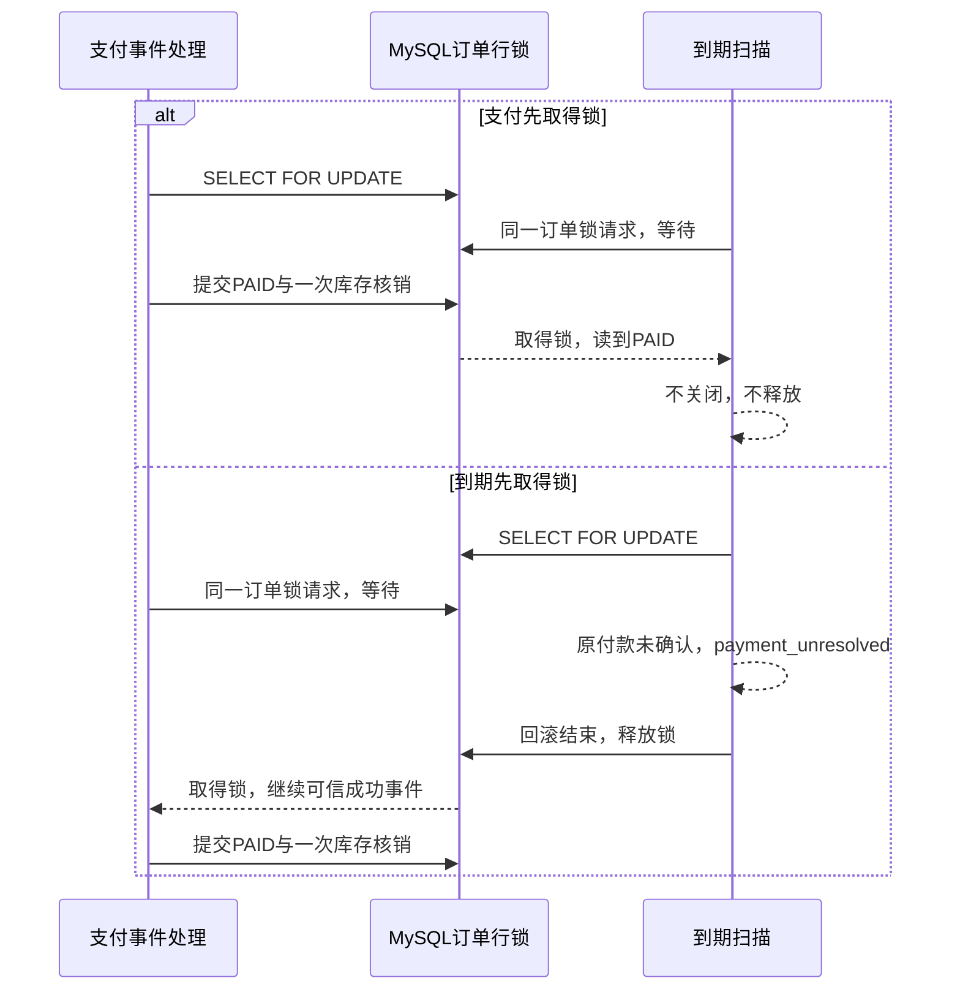

# Phase 5D：付款成功与订单到期同时发生怎么办

这次补齐支付收尾的一段并发证据，属于 Track C / Depth。
现有业务实现没有改变，新增真实 MySQL 测试验证它在两种获锁顺序下仍正确。

## 先记住结论

对于尚未确认付款的原尝试，**到期不等于允许关闭**。
CREATED、PENDING、UNKNOWN 会阻止到期释放库存，必须先查清原付款结果。
付款成功与到期扫描同时处理同一订单时，它们锁同一张订单记录；拿到锁以后
读取最新状态，再决定操作。可信成功最终进入 PAID，库存只核销一次。

术语对应到本项目：

- Concurrency（并发）：两个独立请求或后台流程在相近时间修改同一订单。
- Row Lock（行锁）：一个事务先占住订单记录，另一个修改者等待它结束。
- Transaction（事务）：订单、付款与库存相关修改一起提交；失败时一起回滚。
- Idempotency（幂等）：重复处理同一业务动作，结果仍只有一次核销或释放。

## 189元订单的正常与失败风险

实验鼠标价格189.00元，初始可售库存20，顾客买1件。
下单后可售19、预占1，Order为PENDING_PAYMENT。预占已到期，但存在原付款
尝试：它可能刚创建、供应商仍处理中，或者因为网络超时本地不知道结果。

此时一条可信成功通知与到期扫描同时到来。如果到期代码看到旧状态就释放，
支付代码又按旧状态核销，可能造成状态/库存不一致。本项目先锁Order，再在
锁内检查状态。测试要证明两条实际业务流程确实争用了同一个锁，而不只是
同时启动两个线程，最后碰巧得到正常结果。

## 两种执行顺序

| 谁先取得Order锁 | 第一条流程 | 第二条流程 | 最后结果 |
|---|---|---|---|
| 支付处理 | 核对通知、金额和状态；在同一事务核销库存并提交PAID | 等锁释放后读到PAID，到期操作返回changed=False | PAID；可售19/预占0；COMMIT1；RELEASE0；退款0 |
| 到期关闭 | 读到CREATED/PENDING/UNKNOWN，抛payment_unresolved；事务结束释放锁，不改库存 | 等锁释放后继续原成功事件，提交付款和库存结果 | 同上；到期这次没有关闭订单 |

这两种顺序都在CREATED/PENDING/UNKNOWN三种状态下验证，共六个场景。
不是“先拿锁的流程总能把订单改成自己的目标状态”；拿到锁以后仍要遵守
业务规则。到期流程先拿锁，也不能把尚未确认的支付当成失败。



## 代码在哪，为什么这样写

[到期服务](../../backend/apps/ordering/lifecycle_services.py)中的实际入口：

```python
@transaction.atomic
def expire_pending_order(*, order_id, as_of=None):
    """在指定时刻关闭确实已到期的订单；锁内重查避免与支付竞争。"""

    as_of = as_of or timezone.now()
    order = Order.objects.select_for_update().get(pk=order_id)
    if order.status != Order.Status.PENDING_PAYMENT:
        return order, False
    if not InventoryReservation.objects.filter(
        order_item__order=order, expires_at__lte=as_of
    ).exists():
        return order, False
    return _close_pending_order_locked(order, target_status=Order.Status.EXPIRED), True
```

`select_for_update()`先锁住目标订单；状态判断在其后。支付已经提交PAID时，
到期流程会直接返回False。确实到期且仍待支付时，才进入共用关闭函数。
关闭函数进一步锁原Attempt并检查未确认状态，避免“订单待付，所以一定能关闭”
这个错误推断。

[支付服务](../../backend/apps/payments/services.py)中的实际锁顺序入口片段：

```python
order = Order.objects.select_for_update().get(pk=attempt_hint.order_id)
attempt = PaymentAttempt.objects.select_for_update().get(pk=attempt_hint.pk)
event.attempt = attempt
```

支付先锁Event，再锁Order、Attempt、Reservation、Inventory；关闭流程从
Order开始，后续也按固定顺序锁Attempt和库存。共同的Order锁将该订单的业务
变更串行化；支付验签、金额校验和业务事务仍复用原实现，测试没有第二套规则。
Inbox领取次数在独立短事务持久化，成功事件的业务状态与库存效果在T2共同提交。

## 测试怎样证明存在真实竞争

新文件是[支付与到期并发测试](../../backend/apps/ordering/tests/test_payment_expiration_concurrency.py)。
每个场景用两条独立Django/MySQL连接执行原业务服务。

1. 在一条连接的实际Order锁SQL已经返回后，测试包装器暂缓继续执行。
   此时原事务仍在，订单锁已经取得；包装器不替换SQL结果或业务返回值。
2. 另一条连接执行原Order锁SQL。测试不凭固定sleep猜它是否阻塞。
3. Docker中的只读观察连接读取MySQL `performance_schema`（数据库运行诊断表），
   关联两条测试连接与目标Order主键，必须看到请求锁WAITING和阻挡锁GRANTED。
   观察器与业务连接的server_uuid也必须一致，避免查错MySQL实例。
4. 释放第一条流程，等待两线程结束，再核对Order、Attempt、原成功Event、
   预占、库存流水和退款终值。最后重复原成功通知和到期操作，核对结果仍不变。

应用账号没有诊断表读取权限。实验使用容器现有管理连接只读观察；没有GRANT、
没有修改账号权限，密码只在容器环境中读取，不打印或写入实验记录。
线程有等待上限，finally释放控制信号、join线程、关闭各自数据库连接。

## 怎样运行，怎样看结果

先确认Docker db已经健康、专用支付测试Worker已停止；不能并行启动共享
`test_project_one`的pytest进程。下面命令会创建/迁移/销毁测试库，不操作开发库。

```powershell
$env:DJANGO_ENV = 'test'
$env:MYSQL_DATABASE = 'test_project_one'
$env:MYSQL_TEST_DATABASE = 'test_project_one'
$env:MYSQL_HOST = '127.0.0.1'
$env:MYSQL_PORT = '3307'
$env:CATALOG_CACHE_ENABLED = 'false'
$env:PAYMENT_EVENTS_ASYNC = 'false'
$env:PROJECT_ONE_TEST_EXPIRATION_CONCURRENCY = 'true'
.\.venv\Scripts\python.exe -X utf8 -m pytest backend/apps/ordering/tests/test_payment_expiration_concurrency.py -q -s --tb=short
```

这些配置把业务与观察目标限定为本机隔离MySQL。显式实验开关必需：普通CI使用
GitHub MySQL服务，没有本机Compose db；不开开关时六项明确skip，skip不是通过。
开启后，Docker不可达、锁等待未观察到、服务器不一致或业务终值错误都应失败。

每场景的`PAYMENT_EXPIRATION_LOCK`输出含获锁顺序、初始Attempt状态、锁等待
记录、到期返回与最终业务事实。通过时共六项；可选增加
`PROJECT_ONE_WRITE_EXPIRATION_EVIDENCE=true`才写本期JSON，默认不写。
只有本进程六场景全部完成并通过终值检查才生成完整记录。

本次目标实际 **6 passed in 11.47s**；此前已有两个边界测试实际2 passed、9.00秒。
支付/订单回归实际157 passed、12 MQ skipped、83 subtests（100.14秒）；本期
未重跑真实MQ。详细条件与源码指纹见[验证记录](../verification/phase-5d-payment-expiration-concurrency.md)，
六场景原始观察见[JSON](../verification/phase-5d-payment-expiration-concurrency-data.json)。

## 不能混淆的边界

- 已经合法EXPIRED的订单，之后收到可信成功，应保持EXPIRED并模拟退款一次。
  这是[已有迟到退款分支](../verification/phase-2b-refund-simulation.md)，不属于这六个活跃Attempt竞争场景。
- FAILED原尝试在订单尚未关闭前收到矛盾成功，当前实现拒绝为
  terminal_attempt_conflict；不能在测试中默默改成“所有成功通知都能PAID”。
- UNKNOWN不是失败，网络超时后复用原Attempt查单；不能换新订单或新金额重付。
- 预占可能超过15分钟，因为保护未确认付款优先于准时释放；这项代价必须说明。
- 本次是服务层真实MySQL事务实验，没有运行新的真实RabbitMQ/Worker故障实验，
  也没有验证商业供应商、真实退款、吞吐或所有可能的死锁排列。
- 本期保留人工修复/补投，不新增定时恢复、自动关单或第三方Sandbox。

## 面试怎么讲

**为什么有行锁还要检查状态？** 锁让修改顺序可控，状态判断决定这一轮有没有
资格修改；订单已经PAID或付款尚未确定，都不能按旧扫描结果直接释放库存。

**两个流程同时启动就证明并发正确了吗？** 还不够，可能运行时实际错开了。
本实验控制两种真实获锁顺序，诊断表确认同一主键记录上的阻塞，之后检查副作用。

**锁、事务和幂等分别负责什么？** 锁协调同一订单的竞争，事务避免半完成结果，
状态与唯一业务流水保护重复动作。这三项共同保证一次核销。

**为什么不用Redis分布式锁？** 当前最终业务事实在单个MySQL，数据库已有
共同订单锁与原子事务；额外Redis锁会引入租约/释放/故障问题，本轮没有必要。

**这个实验有什么限制？** 只证明所列六种受控交错；MySQL是真实的，通知与数据
是合成的，没有生产容量和真实供应商证据。

后续学习资料按项目模块进入有层级的飞书Wiki，复用已完成的Redis总结。
本次只完成本地测试与说明，没有发布、迁移或改动飞书内容。
