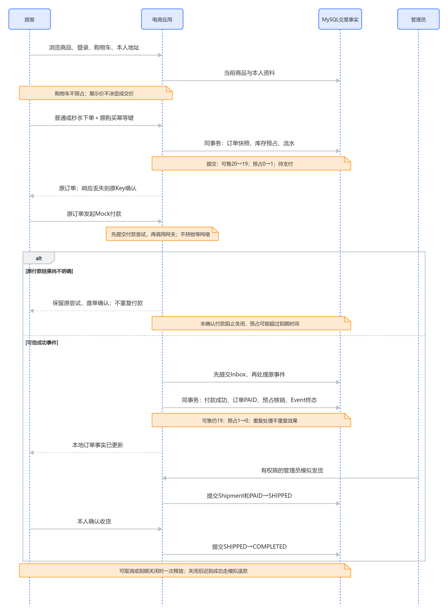

# 电商项目：先看懂交易，再理解技术选择

[归档核对](../verification/project-payment-overview-knowledge-base-update.md) · [飞书项目入口](https://ocnbkcx1ug58.feishu.cn/wiki/WN1jwXDj0iPXm7kwLyHcmneenlb)。

2026-10-11，按源码 `4673b9f`、项目总纲 v1.15 整理。本文是当前项目入口；历史切片保留各自日期和证据，不把本次文档核对写成重新运行实验。

**这个项目要讲清的核心是：顾客提出购买意图以后，系统怎样把它变成可信订单，并在重复请求、库存竞争和依赖故障下守住交易规则。** 业务采用单商家、单仓、Mock支付和模拟物流，技术证据来自真实隔离服务与合成数据。你应能独立解释一条完整流程、一个失败例子和设计代价；技术名称和测试通过不能代替个人掌握。

## 本专题前后变化

原入口以模块导航为主，业务闭环与当前启用范围不够集中。本轮补当前流程、职责、图、少量代码、证据边界与重做选择；保留支付、Redis、秒杀和复盘原入口。没有改变应用实现。

## 一、完整业务流程：什么时刻才算买到了

1. **浏览与选择。** 游客查看商品，选择 SKU（同一商品的具体规格）。页面价格和库存提示帮助选择，不能作为最终交易承诺；搜索也只是找到候选商品。
2. **登录、购物车与地址。** Session（服务器保存的登录会话）确定操作者；修改请求经过 CSRF 防护。购物车保存本人购买意图，不预占库存。下单只能使用本人地址，前端隐藏按钮不能替代后端权限判断。
3. **创建待支付订单。** 后端重新读取当前商品规则、价格和库存，在同一 MySQL 事务内保存订单、商品/地址快照、库存预占和流水，成功后清理本次购物车。事务表示这些变化一起提交，任一步失败就整体撤销。例如库存从可售 10、预占 0 变成可售 9、预占 1；此时还没有最终售出。
4. **支付确认。** 顾客发起 Mock 支付尝试，网关事件先保存进 Inbox（持久收件箱），再校验并处理。浏览器“付款成功”、消息入队或 Worker 的 ACK（确认收到并处理消息）都不能代替数据库事实。支付确认、订单变为 PAID、预占核销和事件处理结果共同提交，重复事件不能重复产生效果。
5. **履约或关闭。** 已支付订单由管理员模拟发货，再由顾客确认收货。未支付订单通过取消或到期扫描关闭并释放预占；写下 15 分钟期限不会自动执行释放。支付结果尚不明确时保留预占等待查单；关闭后迟到的成功由支付规则处理，不能再次售出已经释放的库存。

**响应丢失并不等于交易失败。** Idempotency Key（幂等键：标识同一次购买意图）让同一用户、入口和原参数重试返回原订单，参数改变则拒绝。秒杀是另一种建单入口，增加活动价、限购与资格生命周期，成功后仍进入上述支付和履约流程。



图中普通与秒杀建单只合并其共同结果，不表示库存策略相同；Mock网关调用及MQ细节见[支付当前总览](payment-current-overview-study-guide.md)。

## 二、各技术承担什么，谁保存最终事实

| 模块 | 解决的业务问题 | 必须守住的边界 |
| --- | --- | --- |
| MySQL、订单与库存 | 保存可信交易，协调预占、核销和释放 | 订单、支付、库存以 MySQL 为最终事实；快照不跟随当前资料改动 |
| Redis 浏览缓存 | 减少重复加载，故障时控制回源成本 | 缓存可以陈旧；下单仍重新读取权威价格与库存 |
| 秒杀与 Lua 准入 | 避免超卖，限制进入下单事务的尝试速率 | 单活动 SKU 条件 UPDATE 负责库存；Lua 不预扣库存，也不保证严格在途数量 |
| RabbitMQ 与 Celery | 把支付事件处理交给后台，支持有限重试 | 队列不保存付款终态；提交后漏投和 Worker 中断仍需可恢复记录 |
| Elasticsearch 搜索 | 提供可重建的商品搜索副本 | 返回候选后回读 MySQL 当前可见性、价格与库存提示；尚无自动同步 |

后端采用模块化单体：一个 Django/DRF 代码库按业务职责划分，Worker 复用相同业务处理器。当前范围下，它让跨模块交易规则集中、容易定位和验证。微服务可能提供独立扩容，但也会引入跨服务提交、通信失败和运维成本；当前没有证据要求承担这些成本。

## 三、先抓住一处核心代码

普通购物车下单的库存变化是：

```python
inventory.available_stock -= cart_item.quantity
inventory.reserved_stock += cart_item.quantity
inventory.save(update_fields=("available_stock", "reserved_stock"))
```

它位于 `create_order_from_cart` 的原子事务内，并在锁定库存、确认足够后执行，见[下单源码281行](../../backend/apps/ordering/services.py#L281)。重点是可售转为预占，以及后续流水失败也回滚；单独三个加减语句不能保证并发正确。普通多 SKU 仍用行锁基线；单活动 SKU 秒杀后来用条件 UPDATE，把“够不够”和“扣多少”放进一条 SQL。两条入口不能混成同一锁策略。[下单与预占解释](mvp-3-order-inventory-study-guide.md) · [秒杀正式策略与失败边界](phase-6c5-flash-sale-inventory-failures-study-guide.md)

## 四、已实现、正在启用、实际验证要分开

单 SKU 秒杀条件 UPDATE、临时 5 秒行锁等待和浏览器原意图恢复已有证据；5 秒不是整个 HTTP 请求期限。订单列表固定 20 条和联合索引已实现，真实计划显示首页排序减少，但 COUNT 与深 OFFSET 成本仍存在。

支付已有真实 RabbitMQ/Worker 重复投递、中断和恢复证据，**默认同步，本期人工补漏**。Lua 已实现、真实 Redis 验证，默认关闭。ES 已有隔离原型、候选读接口与手动切换证据，默认关闭且仅测试来源；普通列表和前端仍走 MySQL，不能写成搜索已经全面切换。

独立本机部署已有镜像、新库迁移、三服务健康、14 项 HTTP 和只读浏览器空页证据；缓存、Lua、MQ、ES均关闭。登录 Session/CSRF、交易和中间件启用尚未验收，不能把开发/隔离测试证据搬成这套部署的交易验收。[最新范围](../../PROJECT_CHARTER.md) · [部署运行记录](../verification/phase-9b-local-deployment-run.md)

## 五、如果重新做，我会优先改什么

**更早明确缓存失效失败的恢复要求。** 历史实验真实观察过数据库从 129 元改为 169 元、Redis 换代失败，恢复后又展示旧价。原方案简单且不决定成交价；若业务要求更快恢复新展示，我会评估把商品更新与失效待办一起持久保存，再设计重复、乱序和耗尽的处理。代价是任务生命周期与监控；这是尚未实现的候选，不等于已经保证强一致。[缓存故障证据](../verification/phase-4f-slow-faults-and-recovery.md)

**把测试隔离前移。** 更早核对实际连接身份、明确可清理对象，并评估独立实例或受限账号，避免测试保护只检查配置表象。相关搜索路径后来已有修正；重做改变其出现时机，不宣称全项目已统一隔离。代价是环境和权限维护。[脱敏事故复盘](../verification/phase-7b-test-isolation-incident.md) · [横向重做专题](project-rebuild-retrospective-study-guide.md)

## 六、怎样阅读这套知识库

先沿“购买意图 → 建单预占 → 支付核销 → 关闭或履约”读一遍，再分别深入 Redis、秒杀、支付与 MQ、搜索。每个模块总览优先讲当前业务流程、设计理由、关键机制、替代与代价、证据和重做选择；历史切片解释演进，不要求按编号全部背诵。

已有支付、Redis、秒杀与库存专题继续复用；交易前置、订单查询、商品搜索和部署总览可后续逐步整理，空缺不代表实现不存在。本轮只整理项目与支付总览，不自动创建所有栏目或扩大技术范围。[本地学习导航](README.md)
