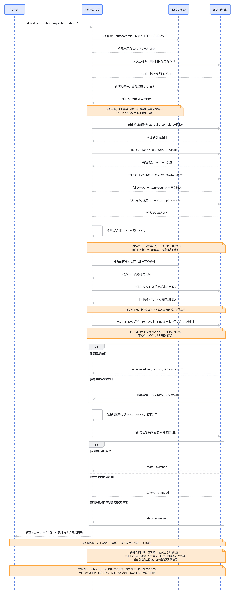

# 怎样重建并安全切换索引？

2026-10-11整理。源码快照：`7ea1963f2a7eec6018852e7d3c17b007d1e6d190`。[搜索总览](../search-current-overview-study-guide.md) · [本轮文档验证](../../verification/search-interview-knowledge-base-publication.md) · [7D历史指南](../phase-7d-search-index-switch-study-guide.md) · [7D真实验证](../../verification/phase-7d-search-index-switch.md)。

**当前方案先完成新候选，再一次提交读入口的关系变更，最后回读实际指向。构建失败与发布结果未知是两种不同情况。** 这页服务于面试中解释“外部系统操作超时后怎样确认结果、为何不能立即删除旧资源”，已有隔离实证足以支撑这个回答，本轮不追加服务实验。

## 本专题前后变化

7B能从MySQL建出新索引，7C能配置精确索引供搜索API读取；但商品改名后，新索引建好了，原入口仍指旧索引。7D增加Alias（别名：让固定读取名称指向实际索引）及手动发布器。现在可在同一构建会话里重建、核对候选、切换并确认结果。能力仍限于隔离测试：没有自动同步、独立管理命令、多操作者协调或开发与部署启用。

## 1. 先看具体业务变化

历史真实测试先建立两个可见商品，旧索引I1有“旧款键盘”和“稳定鼠标”，别名A指向I1。随后MySQL把旧款键盘改名为“新款音箱”，再新增一件同名音箱。此时：

| 时点 | MySQL | 别名A | 搜索“新款音箱” |
| --- | --- | --- | --- |
| 修改前 | 2件商品 | I1 | 0候选 |
| 修改后、未重建 | 3件商品 | I1 | 仍为0候选 |
| 新候选完成、未切换 | 3件商品 | I1；另有I2 | 新读请求仍查I1 |
| 切换并确认后 | 3件商品 | I2 | 2候选 |

不能一开始就删除I1，再慢慢往I2写。批量写入可能失败，那样顾客会失去原本可用的搜索入口。当前方案把“制作新副本”和“发布新副本”拆开；发布成功也只代表入口已换，不代表MySQL以后每次修改都会自动更新I2。

## 2. 候选怎样才算完成

构建前先核对实际MySQL来源，要求自动提交且没有外层事务；不能拿着数据库事务等待ES网络。然后把一次商品查询的结果物化到应用内存，再创建随机的新索引。只导出当前有效商品及分类的标识、名称、描述、分类；价格与库存不进入搜索索引。

新索引最初带`build_complete=False`。Bulk（批量写入：一个请求包含多条文档操作）逐项通过后，还需要refresh让文档可搜索，再核对失败分片、实际文档数及成功写入数。最后才持久写入完成元数据，并放入本构建器内存中的`_ready`集合。

核心摘录来自[构建完成门槛](../../../backend/apps/catalog/search_prototype.py#L124)：

```python
written, _ = helpers.bulk(
    self.client,
    ({"_index": index, "_id": str(doc["product_id"]), "_source": doc} for doc in documents),
    chunk_size=200, max_retries=0, raise_on_error=True, raise_on_exception=True,
)
refreshed = self.client.indices.refresh(index=index)
counted = self.client.count(index=index)
if refreshed["_shards"]["failed"] or counted["_shards"]["failed"]:
    raise RuntimeError("Search index validation returned failed shards.")
actual = counted["count"]
if written != len(documents) or actual != len(documents):
    raise RuntimeError("Incomplete search index build.")
self.client.indices.put_mapping(index=index, _meta=build_metadata(True))
self._ready.add(index)
```

这里不能只看HTTP200。历史测试把一条合法文档和`product_id="invalid"`发给真实ES，Bulk外层HTTP200，一项成功、一项400；部分候选实际只有1条文档，完成标记仍False，未进入`_ready`，别名更新调用为0。原入口仍指完整旧索引。错误字段是测试注入导出内容产生的，不是MySQL实际保存了这个值。

数量与完成标记证明本轮约定的构建门槛；它们不是每字段校验和、不可伪造签名，也不是MySQL与ES的共同事务。来源查询完成后MySQL还可能改变，候选切换时已经稍旧。当前全量物化也有应用内存成本，`chunk_size=200`只控制ES批次，并未把MySQL来源改成流式读取。

## 3. 切换前为什么要记录旧目标

发布不是“把任何现成索引接上去”。[发布前检查](../../../backend/apps/catalog/search_alias.py#L63)要求：

- 实际来源仍为本轮隔离测试库；首次发布`expected_index=None`，以后旧目标必须属于当前构建器会话的完成集合。
- 当前别名的实际目标必须等于`expected_index`；重建前检查一次，候选完成后发布前再检查一次。
- 新候选必须属于本构建会话的`_ready`，名称满足精确随机候选格式，持久元数据仍为完成且来源正确。

例如操作者认为A仍指I1，实际已经指I2，就不能沿着过时的假设继续发布I3。代码会在提交切换前拒绝，要求重新调查入口。`_ready`只在本Python对象内存中：新进程即使看到持久别名，也不能直接接续旧会话发布。这正是当前隔离控制对象的限制。

实际切换代码来自[一次提交关系变更](../../../backend/apps/catalog/search_alias.py#L78)：

```python
actions = []
if expected_index is not None:
    actions.append({"remove": {"index": expected_index, "alias": self.alias, "must_exist": True}})
actions.append({"add": {"index": index, "alias": self.alias}})
```

之后把这一组动作传给一次`update_aliases`请求。`remove`解除旧关系，`add`建立新关系，都不删除索引本体；不存在旧关系时，`must_exist=True`使整组动作失败。这里的原子性指ES内的别名关系变更。[Elastic 8.19官方语义](https://www.elastic.co/guide/en/elasticsearch/reference/8.19/indices-aliases.html)

前后检查之间仍有间隔，它没有锁住多个操作者。**当前依赖单操作者约束；预期旧目标检查不是数据库式Compare-and-Swap（比较交换：只在当前版本符合预期时更新）的完整协调协议。** 也不能把一次别名更新说成商品数据与MySQL跨存储原子提交。

## 4. 请求超时后，入口究竟在哪里

最关键的分界是切换请求有没有提交。构建异常时根本没发别名更新，可说旧入口未被本次构建改变；已经发出更新以后，客户端超时只能说明没有拿到可靠响应，不能证明ES没执行。

正常响应也要检查`acknowledged`、`errors`与逐动作结果，记录`response_ok`。无论收到正常响应，还是捕获更新异常，代码都会回读别名。摘录来自[发布结果确认](../../../backend/apps/catalog/search_alias.py#L98)：

```python
try:
    current = resolve_read_alias(self.prototype.client, self.alias, missing_ok=True)
    state = "switched" if current == index else "unchanged" if current == expected_index else "unknown"
    readback_error = None
except (ApiError, TransportError, SearchAliasInvalid) as exc:
    current, state, readback_error = None, "unknown", type(exc).__name__
```

| 回读结果 | 本次能够确认的事实 | 后续原则 |
| --- | --- | --- |
| `switched` | 回读时指向本次新候选 | 保留记录；更新响应丢失也可与此并存 |
| `unchanged` | 回读时仍为预期旧目标；首次发布可能仍无别名 | 查明发布失败原因，之后再决定操作 |
| `unknown` | 回读失败，或实际目标与新旧预期都不同 | 先调查实际指针及资源，不能按“确定未切”处理 |

`response_ok`回答“收到的更新响应是否完全确认”，`state`回答“后续回读看到了什么”，两者不能合并成一个布尔成功值。官方明确确认等待超时后元数据更新仍可能生效；因此`acknowledged=False`也不直接等于未切换。[Elastic超时说明](https://www.elastic.co/guide/en/elasticsearch/reference/8.19/indices-aliases.html)

历史实证有两轮：真实别名POST完成后，包装器抛`ConnectionTimeout`。第一轮回读成功指I2，报告`switched`；第二轮又注入回读失败，报告`unknown`，独立控制客户端随后确认实际已切。每轮都只写一次，没有盲重发、自动反向回滚或删除任何候选。这是“真实操作后异常注入”，不是实际网络丢包或主节点故障。`unchanged`、未完整ack及坏逐项响应分支本轮只进行了静态核对，不能说都做过真实依赖故障实验。

## 5. 为什么切换之后旧请求还读旧索引

<!-- DIAGRAM:switch-sequence -->



[可编辑图源](../assets/search-interview-2026-10-11/switch-sequence/diagram.mmd)。图展示当前手动方案；对应文字过程如下。

1. 请求A先解析别名A得到I1，记下这个精确索引。
2. 操作者完成I2并把别名切到I2。
3. 请求A继续查询已选定的I1；候选不会在同一请求中被悄悄换成I2。
4. 请求A随后用当前MySQL生成商品摘要，可能展示改名后的“新款音箱”，即使旧候选由“旧款键盘”命中。
5. 后来的请求B重新解析别名，得到I2，因此新词可以找到2件音箱。

[读端每请求解析一次](../../../backend/apps/catalog/search_read.py#L48)的设计让一次读取有确定对象，前提是保留旧索引。刚切换就删I1，会让已选中I1的请求失败。发布器本身不调用`close()`清理；测试只在确认读线程退出以后精确删除本次拥有的索引，不能把测试收尾当成生产安全回收机制。

别名必须仅一个候选、空配置；多个目标、过滤器或routing（路由：限定搜索到哪些分片）都拒绝。因为读端解析后按精确索引查，会绕过别名附带规则，静默忽略它们会改变业务范围。[精确解析约束](../../../backend/apps/catalog/search_alias.py#L29)

这个方案也没有跨页快照。第一页和第二页是不同请求，中间可能切换，相关性及位置可能变化；在途旧候选与当前MySQL摘要也不是同一时点共同快照。保留旧索引解决的是这个受控在途读取，不是所有并发交错或生产零停机保证。

## 6. 当前选择、替代办法和代价

| 方案 | 能改变什么 | 代价与本项目决定 |
| --- | --- | --- |
| 改精确索引配置并重启 | 各实例按新配置开始读取 | 简单，但多实例切换时点可能不同；读端仍支持精确索引，INDEX与ALIAS只填一个 |
| 完成候选后手动切Alias | 固定入口集中改变，旧索引可保留 | 当前采用；别名读多一次GET，新旧空间、人工调查和清理成本存在 |
| 原地更新当前索引 | 不必每次复制完整索引 | 读者可能遇到部分更新或中途失败；需另设计版本和同步，当前未实现 |
| 自动增量同步并定期全量核对 | 降低人工重建导致的陈旧时间 | 需要可靠变更记录、幂等、顺序、删除和补漏；不是仅把重建函数放进Celery |

当前发布器是同会话控制对象，不是面向运维人员的完整命令。客户端零自动重试；多个ES请求各有2秒超时，串行等待可以累加，2秒不是整体重建、搜索或恢复期限。候选完成后源数据继续变化仍会陈旧，别名并不提供自动同步。

## 7. 如果重新做，我会先改哪里

我会保留“新候选完整后发布、未知结果先回读、旧资源不立即删”三项原则。原方案适合单操作者隔离实验，先把发布结果与在途读取讲清，不急着维护整套同步系统。

如果要让另一个进程或操作者可恢复地接续发布，第一步是增加**持久构建记录及数据代次**：记录来源身份、候选、完成状态、预期旧指针与发布结果；当前库名不能区分销毁后重建的同名测试库。随后形成明确的管理入口与未知结果调查流程，按已观察的协调需求决定是否需要发布锁或版本协议。新增元数据本身不能自动证明安全。

旧索引回收也应单独设计，至少确认入口已离开、保留策略与在途请求边界，清理失败可记录再处理；不能把`close()`直接当在线回收任务。若业务确实要求修改后及时可搜，再讨论增量同步，见[故障与一致性页](05-failure-consistency.md)。这些都是重做候选，尚未实现。

采用这些改变的最小证据应覆盖进程中断后的接续、旧来源代次拒绝、竞争发布和有在途读时的清理约束。当前知识库先停在已有7D证据，不自动追加多节点故障、容量矩阵或同步实现。

## 8. 证据支持到哪里

2026-10-10真实隔离环境为MySQL8.4.10、ES8.19.23与客户端8.19.3。7D新5项、旧读与原型回归合计18项通过；另有真实离线1项及目录24项/6子场景。支持正常切换、真实Bulk部分失败不发布、一个受控在途旧读、真实更新后两种异常注入及非法指针拒绝。开发库30表只读摘要未变，测试候选与别名均精确清理。

原始结果见[7D在线JSON](../../verification/phase-7d-search-index-switch-online.json)和[完整记录](../../verification/phase-7d-search-index-switch.md)。本页是本轮源码核对与历史证据整理；没有新应用测试，不宣称自动新鲜度、生产容量、恢复SLA或个人已经独立掌握。
